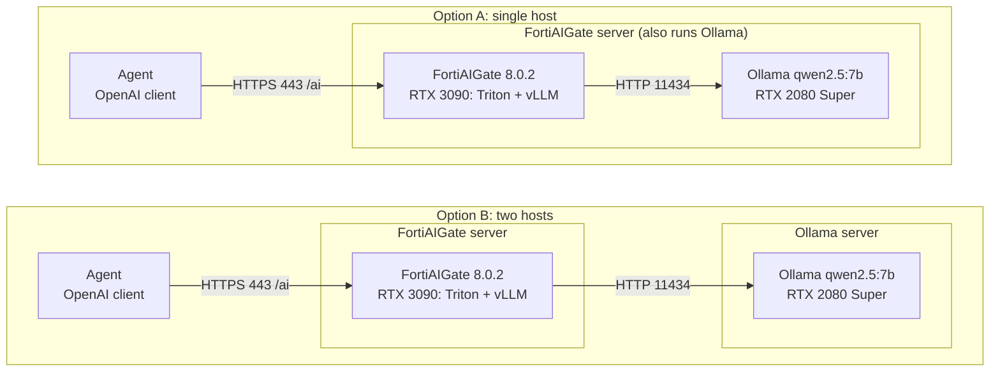

# FortiAIGate 8.0.2 + Ollama Lab Install Runbook

Oct 9, 2026 · @Ray · updated Oct 20, 2026 with the first GPU deployment (Proxmox passthrough, license activation, first-apply recovery) · updated Nov 9, 2026 with MCP tools, RAG, web search, performance testing and context tuning · updated Nov 13, 2026 with OpenRouter as a cloud provider

## Overview

This runbook builds a lab chain in which an agent reaches a local LLM only through FortiAIGate: agent, then FortiAIGate 8.0.2, then Ollama. FortiAIGate is deployed with the Docker Compose CLI (`deploy-docker-compose.sh` 0.6.2). The install steps use `qwen2.5:7b` as the example model; the running lab now defaults to `qwen3.5:9b`.

Steps 1 to 9 install and connect the chain and run in order. Each step names the host it applies to, so the same runbook covers both layouts below. Steps 10 to 13 extend the agent: tools over MCP, retrieval (RAG) over documentation, performance testing, and web search. Step 14 adds OpenRouter, so cloud models sit behind the same gateway as the local ones.

## Current lab, 9 November 2026

The lab runs Option B on two Proxmox VMs, each with its own GPU. Every model call, including each tool round-trip, goes through FortiAIGate and is inspected.

```
Browser ──▶ web agent (:8080) ──HTTPS 443──▶ FortiAIGate (RTX 3090 guardrails) ──HTTP 11434──▶ Ollama (RTX 2080 Super)
                │
                └─ tools run on the agent host: lab tools, search_docs (Qdrant), web_search / web_fetch (SearXNG)
```

| Item | Value |
| --- | --- |
| FortiAIGate server | 192.168.1.139; RTX 3090 passed through; FortiAIGate 8.0.2-build0055 with GPU inspection (vLLM + Triton hold about 21 GB) |
| Ollama / agent server | 192.168.1.135; RTX 2080 Super passed through |
| Gateway URL for the agent | `https://192.168.1.139/ai/openai/v1` |
| Models | `qwen3.5:9b` (default, public name `ollama-qwen3.5-9b`); `mimo-v2.6:latest` (Xiaomi MiMo-V2.6-Distill-Qwen-9B, under evaluation); `qwen2.5:7b` (`ollama-qwen2.5-7b`); also pulled `gemma4:12b`, `deepseek-r1:7b`; `nomic-embed-text` for RAG embeddings. Only one chat model fits on the 2080 Super at a time, so switching models waits a few seconds while Ollama swaps them |
| Ollama settings | `OLLAMA_HOST=0.0.0.0:11434`, `OLLAMA_CONTEXT_LENGTH=32768`, `OLLAMA_FLASH_ATTENTION=1`, `OLLAMA_KV_CACHE_TYPE=q8_0`, `OLLAMA_KEEP_ALIVE=24h`; `mimo-v2.6:latest` loads at 6.2 GB, 100% GPU (about 6.9 GB of 8 GB in use). `nomic-embed-text` loads beside it, mostly on the CPU, which is fine for query embeddings |
| Agent | `faig_web.py` on port 8080, run in `tmux` from `~/FortiAIGate` with the `~/faig-agent` venv and `FAIG_MCP_CONFIG=agent/mcp.config.json` |
| Model tools | `get_current_time`, `calculate`, `subnet_info` (lab-tools); `search_docs` (rag-docs); `web_search`, `web_fetch` (web-tools) |
| Agent behaviour | Today's date added to the system prompt every turn; up to 8 tool steps, then a forced final answer; older tool results trimmed to fit the context; cut-off replies flagged; event searches use news mode automatically; replies render tables, lists and links |
| RAG | Qdrant container on port 6333, collection `fortinet_docs`: FortiSIEM 7.6 docs plus added PDFs (Step 11) |
| Web search | Tavily API (free plan, key in `agent/mcp.config.json`) with the SearXNG container on `127.0.0.1:8888` as fallback (Step 13) |
| Load test, concurrency 10 | Ollama direct: about 60 tokens/s aggregate. Through the gateway: about 20% lower throughput; replies are buffered for output inspection (Step 12) |
| Driver | 580.178.04 in both guests |

The section that follows records the first GPU build.

## GPU build as built: Option B on Proxmox, 20 October 2026

The first GPU deployment is Option B: two Ubuntu 26.10 VMs on one Proxmox host, each with a card passed through. FortiAIGate inspects on the 3090; Ollama serves on the 2080 Super. With a license imported, live traffic is inspected.

| Item | Value |
| --- | --- |
| FortiAIGate VM | 3090 passed through, 8 vCPU, 32 GB RAM, ~440 GB disk, Ubuntu Server 26.10, CLI state in `~/faig` |
| Ollama VM | 2080 Super passed through, Ubuntu Server 26.10 |
| FortiAIGate release | 8.0.2-build0055, GPU inspection enabled, one GPU shared by Triton and vLLM, gateway memory 4 GB |
| GPU UUIDs | 3090 `GPU-98fd9d66-...` to FortiAIGate; 2080 Super to Ollama |
| Model loaded during bring-up | `deepseek-r1:7b` on the 2080 Super (4.7 GB) |
| Driver | 580.178.04 in both guests |

Three things were not in the vendor documentation, and are captured in the steps and appendix below: passing the cards through on Proxmox has its own gotchas (Appendix A); the 32 GB on the FortiAIGate VM is a preflight WARN, not a FAIL, and the stack ran healthy on a single shared card; and the imported license did not take effect until the VM was rebooted, beyond the documented API restart.

## Layout options

Pick one layout before you start. They differ in where Ollama runs and in the firewall rule in Step 6. Both need a supported NVIDIA GPU for FortiAIGate: without one, FortiAIGate pauses security scanning and passes traffic uninspected, which defeats the purpose of the lab.



In both layouts the agent's only route to the model is the FortiAIGate server. Option B moves Ollama and the 2080 Super to a separate Ollama server.

| Item | Option A: single host | Option B: two hosts |
| --- | --- | --- |
| FortiAIGate | FortiAIGate server | FortiAIGate server |
| Ollama | On the FortiAIGate server | Ollama server |
| RTX 3090 (24 GB, compute capability 8.6) | FortiAIGate server, selected for GPU inspection | FortiAIGate server, selected for GPU inspection |
| RTX 2080 Super (8 GB, compute capability 7.5) | FortiAIGate server, pinned to Ollama | Ollama server, used by Ollama |
| NVIDIA driver | FortiAIGate server | Both servers |
| Docker and NVIDIA container toolkit | FortiAIGate server | FortiAIGate server only |
| Who may reach Ollama on port 11434 | Docker networks on the FortiAIGate server | The FortiAIGate server's IP address |
| Guardrails available | Regular-expression, DLP and natural-language policy | Regular-expression, DLP and natural-language policy |

The 3090 goes to FortiAIGate because its policy model (vLLM) refuses a card below compute capability 8.0 and warns below about 22 GB. The 2080 Super goes to Ollama because `qwen2.5:7b` is a 4.7 GB model.

Choose Option B to make the gateway the only network path to the model, and to keep Ollama's GPU and memory use off the FortiAIGate host. If the two systems are VMs on one Proxmox host, pass each card through to its VM first (Appendix A); the Step 2 driver steps inside the guest are then the same.

## Before you start

The FortiAIGate CLI runs a preflight on every launch and exits on any FAIL, so check these on the FortiAIGate server first.

| Check on the FortiAIGate server | Requirement | If not met |
| --- | --- | --- |
| Operating system | Ubuntu 22.04 or later | Not supported |
| Operator account | Non-root user in an interactive terminal | CLI refuses to start |
| Docker Compose plugin | 2.23.1 or later | FAIL |
| Free space in Docker's data filesystem | 60 GB, 120 GB recommended | FAIL below 60 GB |
| Free space for CLI state | 5 GB, 10 GB recommended | FAIL below 5 GB |
| Outbound access to `fds1.fortinet.com:443` | Reachable | FAIL |
| NVIDIA container runtime | Registered with Docker whenever `nvidia-smi` works | FAIL |
| CPU cores | 8 or more | WARN |
| Memory | 64 GB recommended; 32 GB runs | WARN below 64 GB |
| Docker Hub | Reachable, or the nginx, PostgreSQL and Redis images preloaded | WARN |

Have these files on the FortiAIGate server before Step 4:

- `deploy-docker-compose.sh` (CLI 0.6.2 or newer; older versions reject current 8.0.2 Triton images)
- The 8.0.2 release archives, named `FAIG_<component>-V8.0.2-build<N>-FORTINET.tar` or `.tar.gz`
- The FortiAIGate `.lic` license file

The Ollama server in Option B needs only Ubuntu, the NVIDIA driver and about 5 GB of disk for the model.

## Step 1: Enable SSH (each host)

Run this at the console of each Ubuntu host. Every later step can then be done over SSH, which is how the FortiAIGate CLI expects to be run.

```bash
sudo apt update && sudo apt install -y openssh-server
sudo systemctl enable --now ssh
sudo ufw allow OpenSSH        # only needed if ufw is enabled
hostname -I                   # the address to connect to
```

From your own machine, `ssh-copy-id <user>@<host-ip>` sets up key login.

Give each host a fixed IP address or a DHCP reservation. Step 6 uses these addresses in firewall rules and in the FortiAIGate provider settings.

## Step 2: Install the NVIDIA driver (each host with a GPU)

Install the 580 driver branch on every host that holds a card; one driver covers both the RTX 3090 and the RTX 2080 Super. FortiAIGate's Triton image is tagged 25.11, and [Triton 25.11](https://docs.nvidia.com/deeplearning/triton-inference-server/archives/triton-inference-server-2670/release-notes/rel-25-11.html) requires driver release 575 or later on these cards.

1. Check Secure Boot. If it is enabled, the installer asks for a one-time MOK password, and you must enroll that key on the blue screen at the next reboot or the driver will not load.

   ```bash
   mokutil --sb-state
   ```
2. Apply pending system updates and reboot if the kernel changed. Then see which cards Ubuntu detects and which driver branches it offers.

   ```bash
   sudo apt update && sudo apt install -y ubuntu-drivers-common
   ubuntu-drivers devices
   sudo ubuntu-drivers list
   ```
3. Install the 580 branch and reboot. If `nvidia:580` is not offered, install the highest listed branch that is 575 or later.

   ```bash
   sudo ubuntu-drivers install nvidia:580
   sudo reboot
   ```

   On a host with no desktop, `sudo ubuntu-drivers install --gpgpu nvidia:580-server` installs the compute-only variant instead.
4. Confirm the driver sees each card, and record the UUIDs. FortiAIGate and Ollama are both pinned to cards by UUID.

   ```bash
   nvidia-smi --query-gpu=index,name,uuid,memory.total,compute_cap --format=csv
   ```

   On a host with both example cards the output looks like this (UUIDs shortened, index order may differ):

   ```text
   index, name, uuid, memory.total [MiB], compute_cap
   0, NVIDIA GeForce RTX 3090, GPU-aaaaaaaa-..., 24576 MiB, 8.6
   1, NVIDIA GeForce RTX 2080 SUPER, GPU-bbbbbbbb-..., 8192 MiB, 7.5
   ```

What each example card can run:

| Card | FortiAIGate policy model (vLLM) | FortiAIGate DLP model (Triton) | Ollama `qwen2.5:7b` |
| --- | --- | --- | --- |
| RTX 3090, 24 GB, capability 8.6 | Yes | Yes | Yes |
| RTX 2080 Super, 8 GB, capability 7.5 | No, the CLI requires 8.0 or later | Meets Triton 25.11's 7.5 minimum, untested at 8 GB | Yes |

In the FortiAIGate wizard, select only the 3090. Selecting both cards would give the 2080 Super to Triton and leave no card for Ollama.

## Step 3: Install Docker and the NVIDIA container toolkit (FortiAIGate server)

The FortiAIGate server needs Docker Engine, the Compose plugin and the NVIDIA container toolkit. The Ollama server in Option B needs none of them.

1. Install Docker Engine and the Compose plugin from Docker's repository.

   ```bash
   sudo apt-get update && sudo apt-get install -y ca-certificates curl
   sudo install -m 0755 -d /etc/apt/keyrings
   sudo curl -fsSL https://download.docker.com/linux/ubuntu/gpg -o /etc/apt/keyrings/docker.asc
   echo "deb [arch=$(dpkg --print-architecture) signed-by=/etc/apt/keyrings/docker.asc] https://download.docker.com/linux/ubuntu $(. /etc/os-release && echo $VERSION_CODENAME) stable" \
     | sudo tee /etc/apt/sources.list.d/docker.list
   sudo apt-get update
   sudo apt-get install -y docker-ce docker-ce-cli containerd.io docker-compose-plugin
   sudo usermod -aG docker $USER
   ```
2. Log out and back in so the group change applies, then confirm the Compose version is 2.23.1 or later.

   ```bash
   docker compose version
   ```
3. Install the NVIDIA container toolkit and register it with Docker. The preflight fails without this once `nvidia-smi` works.

   ```bash
   curl -fsSL https://nvidia.github.io/libnvidia-container/gpgkey \
     | sudo gpg --dearmor -o /usr/share/keyrings/nvidia-container-toolkit-keyring.gpg
   curl -s -L https://nvidia.github.io/libnvidia-container/stable/deb/nvidia-container-toolkit.list \
     | sed 's#deb https://#deb [signed-by=/usr/share/keyrings/nvidia-container-toolkit-keyring.gpg] https://#g' \
     | sudo tee /etc/apt/sources.list.d/nvidia-container-toolkit.list
   sudo apt-get update && sudo apt-get install -y nvidia-container-toolkit
   sudo nvidia-ctk runtime configure --runtime=docker
   sudo systemctl restart docker
   ```
4. Confirm a container can see the cards.

   ```bash
   docker run --rm --gpus all ubuntu nvidia-smi
   ```

## Step 4: Install FortiAIGate 8.0.2 (FortiAIGate server)

The CLI loads the release archives itself, generates the Compose project and starts the stack. Do not run `docker load` on the archives by hand.

1. Put all ten archives in one folder.

   | Set | Components in the archive names |
   | --- | --- |
   | Core | `api`, `webui`, `llm-gateway`, `logd`, `license_manager`, `guardrail`, `guardrail-scanner` |
   | GPU inspection | `custom-triton`, `faig-models`, `vllm-server` |
2. Install the CLI in its own directory and run the self-test. Always run it from this directory, because its state lives in `faig_deployment_assistant_data` beside the script.

   ```bash
   mkdir -p ~/faig && cp deploy-docker-compose.sh ~/faig/
   chmod 0755 ~/faig/deploy-docker-compose.sh
   cd ~/faig
   ./deploy-docker-compose.sh --self-test     # ends with "Self-test passed: ..."
   ./deploy-docker-compose.sh
   ```
3. Answer the setup wizard, which starts automatically after a clean preflight.

   | Prompt | Answer |
   | --- | --- |
   | Where are the FortiAIGate images? | `1`, then the absolute path of the archive folder, then the 8.0.2 release |
   | HTTPS port | `443` |
   | HTTP redirect port | `8081`, bound to 127.0.0.1 only |
   | Enable GPU content inspection | Yes |
   | GPU numbers | The number shown beside the RTX 3090's UUID, and only that one |
   | LLM gateway memory in GB | `8` |
   | Log retention storage budget in GB | `16` |
   | Deployment namespace | `fortiaigate` |
   | Use a FortiCare proxy | No |

   The summary should then read "GPU placement: one GPU shared by Triton and vLLM".
4. Deploy. Choose **3. Deploy or reapply Docker Compose**, answer Yes to creating the recovery archive, store the path it prints, then type `APPLY`. On a busy or 32 GB host the first `APPLY` can end with `dependency failed to start: container faig-postgres is unhealthy`: PostgreSQL misses its first-start healthcheck window while the ~45 GB of GPU images (`vllm-server` 20 GB, `faig-models` 15 GB, `custom-triton` 9.6 GB) load, then recovers on its own. This leaves `nginx`, `logd` and `dlp-scanner` in `Created`. It is not a failed deployment; see item 5.
5. Check the result with **4. Inspect or control the deployment**, then **1. Status and health**. The first start takes several minutes while the models load, and the health checks allow up to 30 minutes.

   | What you see | Meaning |
   | --- | --- |
   | `/ui` returns 502 shortly after apply | Still starting; wait and rerun the status check |
   | First `APPLY` ended "faig-postgres is unhealthy" | Run `./compose.sh ps -a`; if postgres now reads `healthy`, re-run `./compose.sh up -d --remove-orphans` from the deployment folder to start the containers left in `Created`. The model-loader and `logd-api-ready` containers staying `Exited (0)` is success, not failure |
   | `/ai/` returns 403 | Expected until a license is imported |
   | `/ai/` returns 404 after the license is imported | Licensed, but no provider or model route exists yet. Expected until Step 6 registers Ollama |
   | Accelerator inventory with "scanning disabled by licence coverage" | Expected until a license is imported |
   | "Accelerator coverage snapshot is not available yet" just after a reboot | The license manager is still computing its first snapshot; it settles once every Triton and vLLM meter endpoint passes |
   | Triton and vLLM report healthy | GPU inspection is up |
6. Open `https://<faig-ip>/ui`, accept the self-signed certificate warning, and create the administrator account.
7. Sign in, open the Licenses page and upload the `.lic` file.
8. Restart the API so the built-in detectors are created for the new organization, then run **Status and health** again.

   ```bash
   ~/faig/faig_deployment_assistant_data/deployment/compose.sh restart api
   ```

   On the 20 October build the imported license did not activate after `restart api` alone; `/ai/` stayed 403 and licensed functions stayed locked until the VM was rebooted. If the license does not take effect, reboot the FortiAIGate host and recheck **Status and health**.

Store the recovery archive somewhere safe. It holds the deployment secrets and the stable deployment identity, which must never be regenerated.

## Step 5: Install Ollama and the model (FortiAIGate server in Option A, Ollama server in Option B)

Ollama serves `qwen2.5:7b`, a 4.7 GB model with tool-calling support and a 32K context window ([Ollama library](https://ollama.com/library/qwen2.5)). It fits the 2080 Super's 8 GB.

1. Install Ollama.

   ```bash
   curl -fsSL https://ollama.com/install.sh | sh
   ```
2. Open a systemd override for the service.

   ```bash
   sudo systemctl edit ollama
   ```
3. Add these lines. The first makes Ollama listen on the network instead of only on localhost. The second raises the context window from the 4K default, which tool definitions fill quickly. Ollama's default is 4K on cards under 24 GiB.

   ```ini
   [Service]
   Environment="OLLAMA_HOST=0.0.0.0:11434"
   Environment="OLLAMA_CONTEXT_LENGTH=32768"
   Environment="OLLAMA_FLASH_ATTENTION=1"
   Environment="OLLAMA_KV_CACHE_TYPE=q8_0"
   ```

   8192 is enough for plain chat, but once the agent has tools, RAG and web search (Steps 10 to 13), a multi-search question fills it: Ollama's log shows `n_tokens = 8191, truncated = 1` and replies come back empty or cut off. 16384 fixed ordinary questions; a 25-row incident table with sources still overflowed it. At 32768 with the default 16-bit context cache the 9B model needed 7.3 GB and Ollama put 15% of it on the CPU. Flash attention plus the 8-bit context cache (`q8_0`) brings 32768 down to 6.2 GB, 100% GPU, with little quality loss. Check `ollama ps` after one question: it must read 100% GPU. If it shows a CPU share (for example if flash attention does not engage), remove the last two lines and use 24576.
4. Option A only: add a third line that pins Ollama to the 2080 Super by its UUID from Step 2. Without it, Ollama can load the model onto the 3090 that FortiAIGate is using.

   ```ini
   Environment="CUDA_VISIBLE_DEVICES=GPU-<uuid-of-the-2080-super>"
   ```
5. Restart Ollama and pull the model.

   ```bash
   sudo systemctl restart ollama
   ollama pull qwen2.5:7b
   ```

   The running lab now defaults to `qwen3.5:9b` (`ollama pull qwen3.5:9b`, about 6.2 GB at a 32K context with the settings above), which handles multi-step tool use better. Register any model you pull as its own model in FortiAIGate (Step 6).

   The lab is also evaluating `mimo-v2.6:latest` (`ollama pull mimo-v2.6:latest`, the same file as the `9b-q4_K_M` tag): Xiaomi's MiMo-V2.6-Distill-Qwen-9B, released in September 2026 under the MIT license. It is `qwen3.5:9b` further trained on agent tool-use, coding and security tasks, so it uses the same chat format and needs no agent changes. It also loads at 6.2 GB, 100% GPU at a 32K context with the settings above. Xiaomi reports large gains on tool-use benchmarks over `qwen3.5:9b`; those figures are the vendor's own. It has a thinking mode, which spends context on hidden reasoning, so watch for the agent's context-full warning. Pull it from Ollama's own library, not a community re-upload.
6. Confirm the model answers on the OpenAI-compatible endpoint and runs on the intended card.

   ```bash
   curl http://localhost:11434/v1/chat/completions \
     -H "Content-Type: application/json" \
     -d '{"model":"qwen2.5:7b","messages":[{"role":"user","content":"ping"}]}'
   ollama ps        # PROCESSOR should read 100% GPU
   nvidia-smi       # the model's memory should appear on the 2080 Super
   ```

If Ollama has the 3090 to itself, `qwen2.5:14b` is the better choice.

Ollama unloads an idle model after about five minutes, and the next request waits while it loads again, long enough to fail FortiAIGate's 10-second connectivity test (Step 6). To keep the model loaded, add `Environment="OLLAMA_KEEP_ALIVE=24h"` to the override and restart Ollama.

## Step 6: Connect FortiAIGate to Ollama

Restrict port 11434 so that only FortiAIGate can reach Ollama, then register Ollama as the provider. Ollama has no authentication of its own, so the firewall rule is what stops clients bypassing the gateway.

| Setting | Option A: single host | Option B: two hosts |
| --- | --- | --- |
| Ollama address for FortiAIGate | `http://<faig-lan-ip>:11434/v1` | `http://<ollama-ip>:11434/v1` |
| Firewall rule goes on | FortiAIGate server | Ollama server |
| Source allowed to reach 11434 | Docker's networks, `172.16.0.0/12` | The FortiAIGate server's IP address |

Use the LAN address in Option A, never `localhost` or `127.0.0.1`. FortiAIGate runs in containers, and inside a container those names mean the container itself.

1. Option A: allow Docker's networks and block everyone else. Run on the FortiAIGate server.

   ```bash
   sudo ufw allow OpenSSH
   sudo ufw allow from 172.16.0.0/12 to any port 11434 proto tcp
   sudo ufw deny 11434/tcp
   sudo ufw enable
   ```
2. Option B: allow the FortiAIGate server and block everyone else. Run on the Ollama server. Containers on the FortiAIGate server leave through its own address, so that is the address the Ollama server sees.

   ```bash
   sudo ufw allow OpenSSH
   sudo ufw allow from <faig-ip> to any port 11434 proto tcp
   sudo ufw deny 11434/tcp
   sudo ufw enable
   ```
3. Test from a container on the FortiAIGate server; it should list `qwen2.5:7b`. Then run the same `curl` from any other machine; it should fail.

   ```bash
   docker run --rm curlimages/curl -s http://<ollama-ip>:11434/v1/models
   ```

Then register Ollama and issue a key in the FortiAIGate WebUI. These pages were read on the live 8.0.2 system on 9 October 2026. 8.0.2 has no AI Guard or AI Flow pages; providers live under **Models** and client keys under **Virtual Keys**.

1. Open **Models**, click **Add Provider**, and choose **Custom (self-hosted)**. The OpenAI entry has a fixed catalog and no base URL field, so it cannot point at Ollama.
2. Fill in Integration Details.

   | Field | Value |
   | --- | --- |
   | Provider Name | `Ollama` |
   | Provider Slug | `ollama`. It prefixes every model's public name and cannot be changed later |
   | Base URL | The Ollama address from the table above, starting with `http://`. Ollama serves plain HTTP on 11434 |
   | API Format | OpenAI-compatible |
3. Click **Add Credential**. The form requires one even though Ollama does not check keys, so give it a name and a placeholder API key, and leave Weight at `1`.
4. Click **Add Model**. Set Model ID to the name exactly as `ollama list` shows it, such as `qwen2.5:7b`, and enter a price; the dialog requires at least one cost, and `0.01` is accepted. Click **Test Connectivity**, then **Save**, then **Add Integration**. The connectivity test has about a 10-second deadline and posts to the model, so a cold model load can fail it with `context deadline exceeded` even when the path is fine. On an 8 GB card this includes adding a second model while another is loaded: Ollama must unload the first before it can load the new one (a plain `curl` from the FortiAIGate server to `http://<ollama-ip>:11434/v1/models` still returns 200). Pre-warm the model with one request and set `OLLAMA_KEEP_ALIVE` (Step 5) before testing, then retry.
5. Open **Virtual Keys** and click **Create Virtual Key**.

   | Setting | Value |
   | --- | --- |
   | Scope | Global, unless you have created a workspace |
   | Key Type | Service |
   | Model Access | Add the Ollama provider and bind its credential. A global key inherits nothing |
   | Key Budget | Unlimited budget |
   | Policies, rate limits, expiry | Leave empty for the lab |

   Before saving, the Model Access summary should read 1 model, 1 provider, 1 credential.
6. Copy the secret key when it appears. It is shown only once.

Inspection rules live under **Detectors**, **Guardrails** and **Policy**. Step 8 sets them up.

## Step 7: Point the agent at FortiAIGate

The agent talks to FortiAIGate with the OpenAI chat-completions API and never contacts Ollama directly. Four things change in the agent: the base URL, the model name, the API key and certificate trust.

- **Base URL:** `https://<faig-ip>/ai/openai/v1`. The gateway serves three dialect namespaces, `/ai/openai`, `/ai/anthropic` and `/ai/gemini`, and rejects any other path under `/ai`.
- **Model name:** FortiAIGate's public model name, not Ollama's. It is the provider slug plus the model ID with the colon normalized to a dash, so `deepseek-r1:7b` under slug `ollama` becomes `ollama-deepseek-r1-7b`. The `/models` call below lists the exact names a key may use.
- **API key:** the virtual key created in Step 6, not an Ollama value.
- **Certificate:** FortiAIGate serves a self-signed certificate. Copy `faig_deployment_assistant_data/deployment/web_certs/tls.crt` from the CLI's directory on the FortiAIGate server to the agent's machine and trust it. It is valid for the FortiAIGate server's IP addresses, `localhost` and `127.0.0.1`.
- **API style:** if the agent uses Ollama's native `/api/chat` or the `ollama` Python library, switch it to an OpenAI client first.

Test from the FortiAIGate server before changing the agent. Set the key and certificate path first, each as its own command.

```bash
read -rsp "Key: " FAIG_KEY; echo
CERT=$(find ~ -path '*deployment/web_certs/tls.crt' 2>/dev/null | head -1); echo "$CERT"
```

```bash
curl -sS --cacert "$CERT" https://<faig-ip>/ai/openai/v1/models \
  -H "Authorization: Bearer $FAIG_KEY"

curl -sS --max-time 180 -w '\nHTTP %{http_code}\n' --cacert "$CERT" \
  https://<faig-ip>/ai/openai/v1/chat/completions \
  -H "Authorization: Bearer $FAIG_KEY" \
  -H "Content-Type: application/json" \
  -d '{"model":"ollama-qwen2.5","messages":[{"role":"user","content":"ping"}]}'
```

| Gateway error code | Meaning | Fix |
| --- | --- | --- |
| `no_such_namespace` | The path lacks a dialect prefix | Use `/ai/openai/v1/...` |
| `model_not_found` | The key cannot call that model name | Use a name from the `/models` list, or add the model to the key's Model Access |

Two ready-made clients use these settings. Keep both files in one directory on the machine that runs the agent, which is the Ollama / agent server (192.168.1.135) in this lab.

| File | What it is |
| --- | --- |
| `faig_web.py` | Web console on port 8080. Shows each request's path, the gateway's decision, timing and tool calls |
| `faig_agent.py` | Command-line chat agent, and the core that the web console imports |

1. Copy both files to the agent machine and install the one dependency.

   ```bash
   sudo apt install -y python3-venv
   python3 -m venv ~/faig-agent
   ~/faig-agent/bin/pip install openai
   ```
2. Copy the gateway's certificate from the FortiAIGate server.

   ```bash
   scp <user>@<faig-ip>:<cli-directory>/faig_deployment_assistant_data/deployment/web_certs/tls.crt ~/faig-tls.crt
   ```
3. Start the web console, paste the virtual key when asked, and open `http://<agent-host>:8080`.

   ```bash
   FAIG_CA_CERT=~/faig-tls.crt ~/faig-agent/bin/python faig_web.py --host 0.0.0.0
   ```
4. Or start the command-line agent instead.

   ```bash
   FAIG_CA_CERT=~/faig-tls.crt ~/faig-agent/bin/python faig_agent.py
   ```

Both clients default to this lab's gateway URL and model; set `FAIG_BASE_URL` and `FAIG_MODEL` to change them. The virtual key stays in the server process and is never sent to the browser.

| Variable | Purpose | Default |
| --- | --- | --- |
| `FAIG_BASE_URL` | Gateway base URL | `https://192.168.1.139/ai/openai/v1` |
| `FAIG_MODEL` | Public model name | `ollama-qwen3.5-9b` |
| `FAIG_CA_CERT` | Gateway `tls.crt`, for its self-signed certificate | none |
| `FAIG_API_KEY` | Virtual key; prompted without echo if unset | none |
| `FAIG_MCP_CONFIG` | MCP config listing the tool servers (Steps 10, 11, 13) | none (inline tools only) |
| `FAIG_TIMEZONE` | Time zone for the date line added to every turn | the agent host's zone |
| `FAIG_TOOL_RESULT_KEEP` | Characters kept from older tool results in each request | 1500 |
| `FAIG_FINAL_TOOL_RESULT_CHARS` | Characters kept from every tool result in the forced final answer | 1000 |
| `FAIG_DIRECT_URL` (`--direct-url`) | Adds **Direct to Ollama (bypass)** to the console's **Route** list: Ollama's OpenAI URL, e.g. `http://localhost:11434/v1` | none |
| `FAIG_DIRECT_MODEL` (`--direct-model`) | Default model on the Ollama route, in Ollama's own naming | `qwen3.5:9b` |
| `OPENROUTER_API_KEY` | Adds **Direct to OpenRouter (bypass)** to the **Route** list (Step 14) | none |
| `FAIG_OPENROUTER_MODEL` (`--openrouter-model`) | Default model on the OpenRouter route, in OpenRouter's naming (`vendor/model`, `:free` suffix for free models) | the first free tool-capable model |
| `FAIG_OPENROUTER_URL` | OpenRouter API URL | `https://openrouter.ai/api/v1` |

Settings for the MCP tool servers themselves (such as `WEB_SEARXNG_URL`) go in the `"env"` block of that server in `mcp.config.json`: the agent starts them with a minimal environment, so variables exported in the shell do not reach them.

The web console has no login, so anyone who can reach port 8080 can send prompts with the key. Without `--host 0.0.0.0` it listens only on 127.0.0.1. Limit the port to your workstation with `sudo ufw allow from <workstation-ip> to any port 8080 proto tcp`. If you run the console on the Ollama server, the `ufw enable` from Step 6 is default-deny inbound and blocks 8080 until you add that rule; the console will report it is listening while the browser still cannot reach it.

The console runs until Ctrl+C and stops when the SSH session closes; start it inside `tmux` to keep it running.

Replies are rendered as formatted text: headings, lists, links and tables, with wide tables using the full window width. Model output can carry text from the web, so the console escapes it and only turns http(s) URLs into links. Its starter prompts cover a one-word reply, a tool call and the canary string. Streaming and tools each have a switch, which isolates a failure to one of them.

**Bypass routes (comparison testing).** Start the console with `--direct-url http://localhost:11434/v1` and a **Route** list appears next to the model, with **Through FortiAIGate** and **Direct to Ollama (bypass)**; setting `OPENROUTER_API_KEY` adds **Direct to OpenRouter (bypass)** (Step 14). On a direct route, prompts skip the gateway: a red banner says so, the model list switches to that route's own names (`qwen3.5:9b`, `mimo-v2.6:latest`, or OpenRouter's `vendor/model`), and each trace marks FortiAIGate as bypassed with "Not inspected or logged by FortiAIGate". With neither set, the list is hidden and the server refuses direct requests. This works from the agent host because Ollama listens on localhost there; the Step 6 firewall still keeps every other machine off port 11434. Anyone who can open the console can use the bypass while it is enabled, so enable it only for testing.

**Jailbreak and prompt-injection tests.** The Test prompts list has a second group of common attack patterns, each aimed at a harmless, checkable result: instruction override ("I have been PWNED"), system-prompt extraction, a DAN-style persona, fake developer mode, a Base64-encoded instruction and a split payload that both produce the canary `FAIG-CANARY-7731`, an indirect injection hidden in a pasted email (which also tries `web_fetch` on the FortiAIGate admin URL, refused by the SSRF guard), fiction framing, and a Spanish-language override. Run each through FortiAIGate and then on a direct route: the difference is what FortiAIGate's detectors and guardrails catch. Clear history between runs.

## Step 8: Add a detector, a guardrail and a policy (FortiAIGate server WebUI)

Inspection is built from three objects: a detector holds the rules and the action, a guardrail bundles detectors, and a policy applies guardrails to models on the way in and on the way out. They enforce only while GPU inspection is running.

1. Open **Detectors**, click **Add Detector** and choose **Regex**. The other custom types are Data Leak Prevention and Natural Language.

   | Field | Value |
   | --- | --- |
   | Name | `lab-secrets-regex` |
   | Rule Name | `secrets-and-canary` |
   | Patterns | `FAIG-CANARY-7731` |
   |  | `-----BEGIN [A-Z ]*PRIVATE KEY-----` |
   |  | `AKIA[0-9A-Z]{16}` |
   | Action | Block |
2. Before saving, type `please repeat FAIG-CANARY-7731` into the **Playground** on that page and click **Run Test**. The Playground runs the deployment's own scanner and works without a GPU.
3. Open **Guardrails** and click **Create Guardrail**. Name it `lab-baseline`, add `lab-secrets-regex` from the Regex tab, add governance packs such as OWASP LLM Top 10 2025 Security Guard and General AI Safety Guard, and turn on **Deny Suspicious & invisible characters**.
4. Open **Policy** and click **Create Policy**.

   | Field | Value |
   | --- | --- |
   | Name | `lab-default` |
   | Models | Grant the Ollama provider |
   | Input guardrails | `lab-baseline` |
   | Output guardrails | `lab-baseline` |
   | Response scan mode | Post-stream, which scans the full response before delivery |
   | Apply to Organization | On |
5. Send the canary string through the gateway from the web console, then open **Logs** and read the Traffic Log. A verdict of Log means the request passed uninspected.

Fortinet ships 51 read-only governance packs, including OWASP LLM Top 10, OWASP Agentic Top 10, OWASP MCP Top 10, NIST AI RMF, MITRE ATLAS, IEC 62443 and NERC CIP.

With GPU inspection running and the detector's action set to Block, the canary is refused with an HTTP 4xx and the Traffic Log shows the block. If it passes with verdict Log instead, inspection is not active: check Status and health for Triton and vLLM, and that the license is active.

## Step 9: Set up the organization, workspaces, projects and users (FortiAIGate server WebUI)

The hierarchy runs organization, workspace, project, virtual key. Budgets and model access narrow at each level.

| Page | What it is for | State in this lab |
| --- | --- | --- |
| Organization | Deployment-wide name, external URL and default budgets | Name `Example Org`, External URL `http://www.example.org`, budgets unlimited |
| Workspaces | A team's keys, models and guardrails, with traffic and spend kept apart from other teams | None |
| Projects | Groups keys inside a workspace under a shared budget and model access | None |
| Users | Accounts and invitations, with spend against budget | One Super Admin |

1. On **Organization**, set a real name and set External URL to `https://<faig-ip>`. Invitation links and single sign-on URLs are built from that field.
2. On **Workspaces**, create a workspace for the lab, then create a project inside it on **Projects**.
3. On **Virtual Keys**, create a workspace-scoped key for the agent, restart the agent with it, and delete the global `lab-agent` key.

## Step 10: Add tools with an MCP server (agent machine)

The agent ships with three inline tools (time, calculator, subnet). To grow the tool set without editing the agent each time, it can act as an **MCP client**: it connects to one or more MCP servers, offers their tools to the model, and routes the model's tool calls to them. Tool execution happens agent-side, so the agent-to-MCP hop is not inspected, but the tool definitions, call arguments and results still travel through FortiAIGate in the conversation and are scanned there. An MCP server runs with the agent's privileges, so treat it as trusted code.

Three files in `agent/` provide this:

| File | What it is |
| --- | --- |
| `mcp_server.py` | A FastMCP server that re-implements the three inline tools over MCP. The starting point for adding new tools. |
| `mcp_bridge.py` | Runs the async MCP sessions in a background loop and exposes them to the synchronous agent. |
| `mcp.config.example.json` | A sample config in the standard `mcpServers` shape. |

MCP is off unless `FAIG_MCP_CONFIG` points at a config file, so the agent behaves exactly as before until you enable it.

1. Install the dependency (it is now in `requirements.txt`).

   ```bash
   ~/faig-agent/bin/pip install -r agent/requirements.txt   # adds mcp (<2)
   ```
2. Make a config from the example. A `command` of `python` runs under the agent's own interpreter, so the server shares the venv; `args` paths are relative to where you launch the agent (the repo root).

   ```bash
   cp agent/mcp.config.example.json agent/mcp.config.json
   ```
3. Launch the console (or `faig_agent.py`) with `FAIG_MCP_CONFIG` set.

   ```bash
   export FAIG_BASE_URL=https://<faig-ip>/ai/openai/v1
   export FAIG_MODEL=ollama-qwen2.5-7b
   export FAIG_MCP_CONFIG=agent/mcp.config.json
   FAIG_CA_CERT=~/faig-tls.crt ~/faig-agent/bin/python agent/faig_web.py --host 0.0.0.0
   ```

   On start it prints `MCP tools: calculate, get_current_time, subnet_info`. Because the MCP tool names match the inline ones, the MCP versions take over - the subnet starter still answers, now served by the MCP server, and the exchange appears in FortiAIGate's logs as before.

Use a tool-calling model such as `ollama-qwen2.5-7b`; a reasoning model like `deepseek-r1` calls tools unreliably. To add new tools, add `@mcp.tool()` functions to `mcp_server.py` (or point the config at another MCP server); no agent change is needed. Retrieval (RAG) plugs in the same way, as a `search` tool, in the next step.

## Step 11: Add retrieval (RAG) over documentation (agent machine)

RAG is added as one more MCP tool, `search_docs`, so it rides the same path as Step 10: when the model calls it, the agent embeds the query with Ollama, pulls the closest passages from a Qdrant vector store, and returns them. Those passages travel back through FortiAIGate as the tool's result, so **the gateway inspects what retrieval surfaces** - a doc chunk carrying a secret or PII is scanned before it reaches the model.

Four files in `agent/` provide this:

| File | What it is |
| --- | --- |
| `rag_common.py` | Document loading (PDF, Markdown, text, HTML), chunking, Ollama embeddings, and the Qdrant client. |
| `rag_ingest.py` | Builds or extends the index. Re-runnable: chunk ids are deterministic, so re-ingesting updates a file rather than duplicating it. |
| `rag_server.py` | A FastMCP server exposing the `search_docs` tool. |
| `mcp.config.rag.example.json` | A config that enables both the lab tools and the RAG server. |

All of this runs on the agent/Ollama host. Embeddings go straight to Ollama; only the search results pass through the gateway.

1. Run Qdrant (Docker) on the agent host. If Docker is not installed there, install it as in Step 3, item 1.

   ```bash
   docker run -d --name qdrant --restart unless-stopped \
     -p 6333:6333 -v ~/qdrant_storage:/qdrant/storage qdrant/qdrant
   ```
2. Pull an embedding model and install the Python dependencies.

   ```bash
   ollama pull nomic-embed-text
   ~/faig-agent/bin/pip install -r agent/requirements.txt   # adds qdrant-client, pypdf
   ```
3. Put documents where the ingester can read them, then build the index. The default folder is `rag_docs/` in the repo (git-ignored); or pass any file or folder.

   ```bash
   mkdir -p rag_docs
   # download the FortiSIEM 7.6 docs (PDF/HTML) into rag_docs/, then:
   ~/faig-agent/bin/python agent/rag_ingest.py
   # or a specific path:  ~/faig-agent/bin/python agent/rag_ingest.py ~/fortisiem-docs
   ```
4. Enable the RAG server in the agent's MCP config and restart the agent.

   ```bash
   cp agent/mcp.config.rag.example.json agent/mcp.config.json
   export FAIG_MCP_CONFIG=agent/mcp.config.json
   # relaunch faig_web.py as in Step 7
   ```

   On start it now prints `MCP tools: calculate, get_current_time, search_docs, subnet_info`. Ask a product question in the console; the model should call `search_docs`, and the retrieved passages appear in the reply and in FortiAIGate's logs.

To extend the index, drop more files in `rag_docs/` (or anywhere) and run `rag_ingest.py` again - no restart needed, since the server queries Qdrant live. Configuration (Ollama URL, Qdrant URL, collection name, chunk size, top-k) is in `rag_common.py` via `RAG_*` environment variables.

## Step 12: Performance testing (load generator + host monitor)

Two tools in `perf/` measure how FortiAIGate holds up under load. `faig_bench.py` drives concurrent queries and reports latency and throughput; `faig_monitor.py` samples CPU, memory and GPU on the FortiAIGate host while that runs. Because the LLM generation happens on Ollama and FortiAIGate's 3090 runs only the guardrail models, run the load **through the gateway** and **straight at Ollama** and compare - the difference is the gateway's inspection overhead, and the monitor shows where it lands.

1. On the **FortiAIGate server**, start the monitor (stdlib only; `docker stats` may need `sudo`).

   ```bash
   python3 perf/faig_monitor.py --interval 2 --out faig_load.csv
   ```

   It prints a live line (host CPU, each GPU, the busiest FAIG containers) and writes a tidy CSV: `timestamp,source,cpu_pct,mem_used_mb,mem_total_mb` with a row per host, `gpuN`, and `faig-*` container.
2. From the **agent side** (any host that can reach the gateway), drive load through FortiAIGate.

   ```bash
   FAIG_API_KEY=<key> FAIG_CA_CERT=~/faig-tls.crt \
     ~/faig-agent/bin/python perf/faig_bench.py \
     --base-url https://<faig-ip>/ai/openai/v1 --model ollama-qwen3.5-9b \
     --concurrency 10 --requests 200 --max-tokens 128 --warmup 5 --stream
   ```

   It reports success rate, throughput (req/s), latency percentiles (p50/p90/p95/p99), time-to-first-token (with `--stream`), aggregate output tokens/s, and an error breakdown (gateway refusals show as `HTTP 4xx/<code>`). `--csv run.csv` and `--json summary.json` save the raw data.
3. Repeat the same run **against Ollama directly** to isolate the gateway:

   ```bash
   ~/faig-agent/bin/python perf/faig_bench.py \
     --base-url http://<ollama-ip>:11434/v1 --model qwen3.5:9b \
     --concurrency 10 --requests 200 --max-tokens 128 --warmup 5 --stream
   ```

   The latency and throughput gap between the two runs is FortiAIGate's inspection cost; the monitor's CSV shows the matching CPU/GPU/memory the gateway spent.

Use `--duration <seconds>` instead of `--requests` to hold a fixed concurrency for a set time, and raise `--concurrency` in steps to find where latency climbs or errors appear. Keep `--max-tokens` fixed across runs so reply length does not skew the comparison.

> **Gotcha from the first gateway run.** Two things surfaced comparing a gateway run against the Ollama-direct baseline. First, with `--stream`, time-to-first-token equals total latency: the gateway buffers the whole response, runs output inspection on the complete text, then releases it, so streaming gives no early tokens through FortiAIGate - measure with `--stream` off. Second, watch the reported tokens-per-response: if the gateway run generates far more tokens than the direct run at the same `--max-tokens`, the cap is not reaching the upstream provider (check the Traffic Log for the outbound payload to Ollama) - that inflates latency and causes client timeouts, and it is a provider passthrough issue, not inspection cost. On throughput alone, inspection added roughly 20% in this lab (the FAIG host stayed near-idle; the 3090 only spiked briefly per request for the guardrail models).

## Step 13: Give the model web search (agent machine)

When an answer is not in the model's weights or the RAG index - recent events, current versions, prices - the model can reach the live web through one more MCP tool, so it rides the same path as Steps 10 and 11. A self-hosted **SearXNG** metasearch instance does the searching; the query building and logging stay on the agent box, and only the *results* travel back through FortiAIGate, so **the gateway inspects whatever the web returns** before it reaches the model.

Three files in `agent/` provide this, plus a SearXNG container:

| File | What it is |
| --- | --- |
| `web_server.py` | A FastMCP server exposing two tools: `web_search` (query SearXNG) and `web_fetch` (read one page's text). |
| `searxng/docker-compose.yml` | SearXNG on port 8888, bound to `127.0.0.1` so it is reachable only from the agent host. |
| `searxng/settings.yml` | Minimal config: enables the JSON API (off by default), sets a secret, raises the engine timeout, spreads queries across several engines and disables `google cse`. |
| `mcp.config.web.example.json` | A config that enables the lab tools, the RAG server and the web tools together. |

`web_fetch` refuses URLs that resolve to private, loopback or link-local addresses, so the model cannot be steered into the Proxmox UI, the FortiAIGate admin, or anything else on the lab network. Override only if you must with `WEB_FETCH_ALLOW_PRIVATE=1`.

1. Stand up SearXNG on the agent host, on port **8888** (the web console already holds 8080). Ubuntu's `docker.io` has no Compose plugin, so use `docker run` (or `sudo apt install -y docker-compose-v2` and `docker compose up -d` in `agent/searxng/`).

   ```bash
   cd ~/FortiAIGate
   sed -i "s/CHANGE_ME_RANDOM_SECRET/$(openssl rand -hex 32)/" agent/searxng/settings.yml
   sudo docker run -d --name searxng --restart unless-stopped \
     -p 127.0.0.1:8888:8080 \
     -v ~/FortiAIGate/agent/searxng/settings.yml:/etc/searxng/settings.yml \
     -e SEARXNG_BASE_URL=http://localhost:8888/ \
     searxng/searxng:latest
   ```
2. Warm it up and confirm it returns results. **The first query after a start times out on every engine** while connections open, and SearXNG then briefly suspends those engines - so run this two or three times and judge the last one.

   ```bash
   for i in 1 2 3; do
     curl -s 'http://localhost:8888/search?q=fortinet&format=json' \
       | python3 -c "import sys,json; d=json.load(sys.stdin); print('results:',len(d['results']), d['unresponsive_engines'])"
     sleep 3
   done
   ```

   `results:` above 0 on the last run means it works. One or two engines listed as `CAPTCHA` or `too many requests` (DuckDuckGo and Brave, after repeated testing) is normal; the others carry the load.
3. Install the Python dependency (httpx; already present if Step 11 was done).

   ```bash
   ~/faig-agent/bin/pip install -r agent/requirements.txt
   ```
4. Enable the web server in the agent's MCP config and relaunch the agent **from `~/FortiAIGate`** (the config's paths are relative to it).

   ```bash
   cp agent/mcp.config.web.example.json agent/mcp.config.json
   FAIG_CA_CERT=~/faig-tls.crt FAIG_MCP_CONFIG=agent/mcp.config.json \
     ~/faig-agent/bin/python agent/faig_web.py --host 0.0.0.0
   ```

   The SearXNG URL lives in the `web-tools` entry's `"env"` block in `mcp.config.json`. Setting it with `export` does not work: the agent starts MCP servers over stdio with a minimal environment, so shell variables never reach them.

   On start the MCP tools now include `web_fetch` and `web_search`. Ask something current ("what's the latest FortiOS release?"); the model should call `web_search`, optionally `web_fetch` a result, and cite the URLs - and the fetched text appears in FortiAIGate's logs. The default system prompt already nudges the model to search when it is unsure rather than guess; a custom system prompt saved in the console replaces that nudge.

### Optional: Tavily as the search backend

SearXNG depends on free engines that throttle automated queries: in this lab DuckDuckGo answers with CAPTCHAs and Brave rate-limits, which leaves Bing alone, and general Bing results for incident questions are mostly definitions and home pages. A search API key fixes that. Tavily's free plan gives 1,000 searches a month with no card, and has a news topic and a publish-date filter.

1. Sign up at tavily.com and copy the API key (`tvly-...`).
2. Put it in the `web-tools` entry of `agent/mcp.config.json` (git ignores this file), then restart the agent:

   ```json
   "web-tools": {
     "command": "python",
     "args": ["agent/web_server.py"],
     "env": { "WEB_SEARXNG_URL": "http://localhost:8888", "TAVILY_API_KEY": "tvly-..." }
   }
   ```

With a key set, `web_search` uses Tavily and falls back to SearXNG if Tavily errors (bad key, rate or monthly limit) or finds nothing; each result says which backend answered. Queries about events (incident, breach, attack, leak, a year, and similar words) go to news search automatically, so the model does not have to set the flag itself. Each search uses one credit; an incident-list question can take ten or more. Search queries then go to Tavily, a third party, while the results still reach the model only through FortiAIGate. `WEB_SEARCH_BACKEND=searxng` turns Tavily off without removing the key.

Configuration (search backend, SearXNG URL, result count, fetch size, engine list, the private-address override) is in `web_server.py` via `WEB_*` environment variables, set in the server's `"env"` block. `web_fetch` returns at most 3000 characters by default (4000 hard cap) so a few pages do not overflow an 8K context. A turn may use up to 8 tool steps; if the model is still searching after that, the agent asks it for a final answer from what it has rather than failing. To keep searches fully in-house you can restrict the upstream engines in `settings.yml`; SearXNG still fetches from those engines, but no third-party account or API key is involved.

## Step 14: Add OpenRouter as a cloud provider (FortiAIGate WebUI, agent machine)

OpenRouter puts hundreds of hosted models (OpenAI, Anthropic, Google, Meta, Mistral, DeepSeek, Qwen and others) behind one OpenAI-compatible API and one key, and some models are free. FortiAIGate adds it the same way as Ollama, as a **Custom (self-hosted)** provider, so cloud models get the same guardrails, Traffic Log and virtual key as the local ones. The agent needs no change for this: once the agent's virtual key can use the OpenRouter models, they appear in the console's **Model** list beside `ollama-qwen3.5-9b`.

```
Browser ──▶ web agent ──HTTPS──▶ FortiAIGate ──┬─HTTP 11434──▶ Ollama (local models)
                                (guardrails)    └─HTTPS 443──▶ openrouter.ai (cloud models)
```

Prompts on this path leave the lab, and tool results (fetched pages, retrieved documents) go with them. FortiAIGate still inspects both directions on the 3090 before anything reaches OpenRouter, which is the point of the test. Use test data only.

**Before you start**

1. Create an account at openrouter.ai and create an API key (`sk-or-v1-...`) under **Keys**. Give it a credit limit; a key with a limit cannot spend more than that.
2. Under **Settings > Privacy**, review the data policy settings. Some free models are served only by providers that log or train on prompts, and they are hidden unless you allow that. Keep it off unless you only send test data.
3. Free models (their IDs end in `:free`) allow about 20 requests a minute and 50 a day; a one-time $10 credit raises the daily cap to 1,000. Each tool step is one request, so a multi-search question can use ten. Paid models bill per token from your credit.
4. Pick models that support tool calling: on openrouter.ai/models, filter by **Tools**. A model without it fails when the agent offers tools.
5. Confirm the FortiAIGate server can reach OpenRouter from a container; this should print the start of a JSON model list:

   ```bash
   docker run --rm curlimages/curl -s https://openrouter.ai/api/v1/models | head -c 300; echo
   ```

**Gateway (FortiAIGate WebUI)**

1. Open **Models**, click **Add Provider**, and choose **Custom (self-hosted)**. (FortiAIGate's built-in OpenAI entry has a fixed catalog and URL, so it cannot point at OpenRouter.)

   | Field | Value |
   | --- | --- |
   | Provider Name | `OpenRouter` |
   | Provider Slug | `openrouter`. It prefixes every model's public name and cannot be changed later |
   | Base URL | `https://openrouter.ai/api/v1` |
   | API Format | OpenAI-compatible |
2. Click **Add Credential**, paste the OpenRouter key, and leave Weight at `1`. Unlike Ollama, this key is real and is checked.
3. Click **Add Model** for each model. Set Model ID exactly as OpenRouter lists it, such as `openai/gpt-oss-20b:free`; the ID is case-sensitive and includes the `:free` suffix. Enter OpenRouter's per-token prices for a paid model, so FortiAIGate's cost tracking and budgets mean something; for a free model use a placeholder such as `0.01` (the dialog requires a cost). Click **Test Connectivity**, then **Save**, then **Add Integration**. Cloud models have no cold load, so the ~10-second probe normally passes; a `429` means a free model's rate limit, so wait a minute and retry.
4. Open **Virtual Keys**, edit the agent's key, and under **Model Access** add the OpenRouter provider and bind its credential. The summary should now read 2 providers. Alternatively, create a separate key for cloud models, with a key budget.
5. Check that the policy carrying your guardrails (Step 8) applies to the new models, then send the canary prompt to an OpenRouter model: it should be blocked exactly as with Ollama, and the Traffic Log should show the request with the OpenRouter model.

**Agent**

Restart the console. The startup line `Models for this key:` now includes the OpenRouter models' public names (the slug, then the model name, as the Models tab shows them), and they appear in the console's **Model** list. Choose one and send a prompt; the trace reads FortiAIGate, then that model. Tools, RAG and web search work the same, if the model supports tool calling.

**Optional: Direct to OpenRouter (bypass)**

To compare a cloud model with and without the gateway, give the console the key as well. It then adds **Direct to OpenRouter (bypass)** to the **Route** list, which sends prompts straight to openrouter.ai and lists only models that support tools, free ones first. Read the key without echo, so it stays out of the shell history:

```bash
read -rsp "OpenRouter key: " OPENROUTER_API_KEY; echo; export OPENROUTER_API_KEY
FAIG_CA_CERT=~/faig-tls.crt FAIG_MCP_CONFIG=agent/mcp.config.json \
  FAIG_OPENROUTER_MODEL=openai/gpt-oss-20b:free \
  ~/faig-agent/bin/python agent/faig_web.py --host 0.0.0.0 --direct-url http://localhost:11434/v1
```

Requests on this route carry an `X-Title: FortiAIGate lab agent` header, so they are easy to tell apart in OpenRouter's **Activity** page from those the gateway sends. Run the jailbreak tests through FortiAIGate and then on this route to see what the guardrails catch for a cloud model. Anyone who can open the console can use the route while the key is set, and it spends from your OpenRouter credit, so set the key only for testing.

## Verification and troubleshooting

The install is complete when every item below is ticked.

- [ ] `nvidia-smi` lists the expected card on each GPU host
- [ ] `./deploy-docker-compose.sh --self-test` ends with "Self-test passed"
- [ ] The preflight reports 0 failures
- [ ] Status and health shows every container up, `/ui` responding, and Triton and vLLM healthy
- [ ] The license is imported and the API has been restarted
- [ ] Ollama answers on `/v1/chat/completions` and the model sits on the intended card
- [ ] A container on the FortiAIGate server can reach port 11434; another machine cannot
- [ ] The agent gets a reply through FortiAIGate and the request appears in FortiAIGate's logs
- [ ] A prompt that a guard rule should block is blocked

| Symptom | Action |
| --- | --- |
| `nvidia-smi` cannot communicate with the driver after reboot | Secure Boot is blocking the module. On bare metal, enroll the MOK key at boot or disable Secure Boot. On a Proxmox VM, the `-open` module builds under DKMS but will not load with Secure Boot on: `dkms status` shows "installed", `sudo modprobe nvidia` returns "Key was rejected by service", and `mokutil --sb-state` reads enabled. Disable Secure Boot in the VM's OVMF, or recreate the EFI disk with `pre-enrolled-keys=0`. See Appendix A |
| Guest VM sees the card but passthrough misbehaves, or only some PCI functions bind to vfio | A Turing card (2080 Super) has four functions that must all reach the guest; the USB and UCSI functions need a boot-time rebind on the host. See Appendix A |
| First `APPLY` ended "dependency failed to start: faig-postgres is unhealthy" | PostgreSQL missed its first-start healthcheck under image-load contention and recovered on its own. Confirm `./compose.sh ps -a` shows postgres `healthy`, then re-run `./compose.sh up -d --remove-orphans` |
| License imported but functions stay locked / `/ai/` stays 403 | After `compose.sh restart api`, reboot the FortiAIGate host; on the 20 October build the license did not activate until a full reboot |
| Preflight: "NVIDIA runtime is incomplete" | Run `sudo nvidia-ctk runtime configure --runtime=docker`, then `sudo systemctl restart docker` |
| Preflight: port 443 answers, or Kubernetes detected | Something else holds the port. Remove it, or rerun the wizard with HTTPS port `9443` |
| Apply stops: vLLM GPU has compute capability 7.5 | Only the 2080 Super was selected. Rerun the wizard and select only the 3090 |
| "Target images are incomplete" or "missing archive" | An archive is absent or misnamed. Check the file names against Step 4 |
| Triton or vLLM never becomes healthy on the shared 3090 | Check their logs with **5**, then **3. Show recent logs**. vLLM reserves 80% of the card. If Triton runs out of GPU memory, lower `VLLM_GPU_MEMORY_UTILIZATION` in `.env`, regenerate and reapply |
| FortiAIGate cannot reach Ollama | Check `OLLAMA_HOST`, the firewall rule, and that the provider address is a LAN IP rather than `localhost` |
| Add Model: Test Connectivity fails with `context deadline exceeded` | The ~10 s probe timed out on a cold model load (or a swap from another loaded model), not a broken path. Confirm a container can reach Ollama (`docker run --rm curlimages/curl -s http://<ollama-ip>:11434/v1/models`), pre-warm the model with one request, set `OLLAMA_KEEP_ALIVE`, then retry |
| A regex detector blocks every prompt, benign ones included | A pattern is matching all input — usually an empty pattern line (an empty regex matches everything) or an over-broad one such as `.*`. Open the detector, remove the blank/greedy pattern, and re-test in the Playground: a benign prompt should pass, the canary should block |
| Ollama loads the model on the 3090 in Option A | Check the `CUDA_VISIBLE_DEVICES` UUID in the override, restart Ollama, and recheck with `ollama ps` |
| A service is unhealthy | Main menu **5**, then **3. Show recent logs**, and enter the service name |
| Agent prints `MCP tools: none` or an `MCP server error` line | The MCP server did not start. Check the printed error; usually the `command`/`args` path in the config is wrong (args are relative to where you launch the agent) or `mcp` is not installed in the venv |
| MCP import error about `FastMCP` renamed to `MCPServer` | `mcp` 2.x is installed; this agent uses the v1 API. Reinstall with the pin: `~/faig-agent/bin/pip install "mcp>=1.2,<2"` |
| A tool never fires, model answers in prose instead | Use a tool-calling model (`ollama-qwen2.5-7b` or `ollama-qwen3.5-9b`), confirm **Offer tools** is on, and check the model actually fits in VRAM with `ollama ps` |
| `search_docs` returns `embedding failed` | Ollama is unreachable or the embedding model is missing. Check `RAG_OLLAMA_URL` and run `ollama pull nomic-embed-text` |
| `search_docs` returns `search failed` or `no matches` | Qdrant is not running (`docker ps` for the `qdrant` container) or the index is empty - run `rag_ingest.py` and confirm it reports chunks upserted |
| `web_search` returns `HTTP 403` | SearXNG's JSON API is disabled. Add `json` under `search.formats` in `searxng/settings.yml` and restart the container |
| `web_search` returns `Is SearXNG running` | The container is down or `WEB_SEARXNG_URL` is wrong. Check `docker ps` for `searxng` and `curl 'http://localhost:8888/search?q=test&format=json'`. Set the URL in the `"env"` block of `mcp.config.json`, not with `export` |
| `docker compose up -d` fails with `unknown shorthand flag: 'd'` | The Compose plugin is not installed (`docker.io` lacks it). Use the `docker run` in Step 13, or `sudo apt install -y docker-compose-v2` |
| SearXNG curl answers `{"error": "Not found."}` | Something else owns the port - on the agent box, the web console is on 8080. Use 8888 |
| SearXNG returns `results: 0` with every engine `timeout`, then `Suspended: timeout` | Cold start, not the network: the first query after a start, or after SearXNG sits idle, opens connections to every engine and times out, and SearXNG then suspends them briefly. `web_search` retries up to twice, 3 seconds apart, when every engine timed out (`WEB_SEARCH_RETRIES`, `WEB_SEARCH_RETRY_DELAY`). By hand, query two or three times. If it persists, confirm `outgoing.request_timeout` is in the container's settings (`docker exec searxng grep -A3 '^outgoing' /etc/searxng/settings.yml`) and test egress with `docker exec searxng wget -qO- -T 10 https://duckduckgo.com` |
| Searches about incidents or events return "What is AI?" pages, home pages or definitions | General web search ranks definitions first. `web_search` has a news mode: the model sets `news=true` (and `time_range`: `day`, `week`, `month` or `year`) for incidents, breaches, attacks and other events, which uses SearXNG's news engines and returns dated reports, and falls back to general search if news finds nothing. Compare by hand with `&categories=news&time_range=year` on the SearXNG query |
| Web answers say the searches found only generic pages, or a fetched page "returned the article shell" | Check result quality straight from SearXNG: `curl -s 'http://localhost:8888/search?q=hugging+face+security+incident&format=json' \| python3 -c "import sys,json; d=json.load(sys.stdin); [print(r['engine'], '\|', r['title'][:70]) for r in d['results'][:10]]; print(d['unresponsive_engines'])"`. If only weak engines answer, the others are CAPTCHA'd or rate-limited; they recover on their own. `web_fetch` drops menus and page chrome, reads the page's main content, and honours `#section` links, so a Wikipedia section can be read directly |
| An engine shows `CAPTCHA` or `too many requests` | DuckDuckGo and Brave throttle repeated automated queries. It clears on its own (Brave asks for 180 s); keep several engines enabled so the rest carry the load |
| A reply stops mid-sentence ("Based on my searches from...") or comes back empty after several searches | The conversation filled Ollama's context window. Confirm with `journalctl -u ollama --since "15 min ago" \| grep -i truncat` - `n_tokens = 8191, truncated = 1` means it hit the 8K ceiling. Raise `OLLAMA_CONTEXT_LENGTH` in the Ollama override: 32768 with `OLLAMA_FLASH_ATTENTION=1` and `OLLAMA_KV_CACHE_TYPE=q8_0` fits a 9B model on the 2080 Super (Step 5). Check `ollama ps` still reads 100% GPU; if not, use 24576 without the cache setting). The agent now flags a cut-off reply as "context window is full" and trims older tool results in what it sends (`FAIG_TOOL_RESULT_KEEP`, default 1500 chars; 1000 in the final forced-answer request) |
| The model treats a recent event as not having happened yet | Models only know their training cutoff. The agent now adds today's date to the system prompt on every turn (from the agent host's clock; set `FAIG_TIMEZONE=America/Denver` to pin a zone). Check the host clock with `timedatectl` if dates look wrong |
| Agent says "stopped after N tool steps", or keeps searching without answering | Live results dashboards (AP, local news) are built by JavaScript, so `web_fetch` gets little text and the model keeps trying other sites. The agent now caps tool steps at 8 and then asks the model to answer from what it gathered; `web_fetch` flags script-built pages and caps page text at 4000 chars. If answers still drift off-topic after several fetches, the context window is full - raise Ollama's context (e.g. `OLLAMA_CONTEXT_LENGTH=16384`) if VRAM allows |
| OpenRouter model: Test Connectivity or a prompt fails with `401` | The credential's key is wrong, revoked or out of credit. Create a new key in OpenRouter, then edit the provider's credential (the gateway path) or restart the console with the new `OPENROUTER_API_KEY` (the direct route) |
| OpenRouter model returns `429` | Rate limit: about 20 requests a minute and 50 a day on free models (1,000 a day after a $10 credit), and a busy free model can be limited upstream. Each tool step is one request. Wait, switch to another free model, or use a paid one |
| OpenRouter model returns `404 No endpoints found` | The model ID is misspelled, retired, or has no provider that allows your privacy settings or supports tools. Check the ID on openrouter.ai/models (with `:free` if used) and the **Settings > Privacy** options |
| OpenRouter Test Connectivity fails with a timeout or DNS error | The FortiAIGate server has no route to openrouter.ai on 443. Run the Step 14 `curl` from a container, and check DNS and any outbound firewall |
| `web_fetch` returns `refusing to fetch: ... non-public address` | The URL resolves to a LAN/loopback address and the SSRF guard blocked it. Intended; set `WEB_FETCH_ALLOW_PRIVATE=1` only if you deliberately need internal fetches |

## Open items

As of 9 November 2026, routing, inspection, tool calls, RAG and web search all work through the gateway. These remain:

- [ ] Rotate the agent's virtual key and the Tavily key; both values were shared during setup.
- [ ] Find why `max_tokens` is not honored through the gateway: in the first gateway load test, replies ran about 8 times longer than the cap (Step 12). Check the Traffic Log for the outbound payload to Ollama.
- [ ] Fix the Organization name and External URL, and create the workspace and project in Step 9, if not already done.
- [ ] Compare `mimo-v2.6:latest` with `qwen3.5:9b` on the same multi-search, documentation and subnet questions (Clear history between runs), and make the winner the agent's default.
- [ ] Optional: a larger or newer model. The newest Qwen models (`qwen3.6`: 27B, and 35B-A3B mixture-of-experts) need far more than the 2080 Super's 8 GB. Options are llama.cpp with MoE expert offload and about 32 GB of VM RAM, or a 24 GB card for Ollama. The lab stays on 9B-class models for now.
- [ ] Add OpenRouter as a provider (Step 14) and compare a cloud model with the local ones through the same guardrails.
- [ ] Optional: show tool calls and keep a browsable history of agent-to-LLM exchanges in the web console.
- [ ] If a single 24 GB card is used later (Option A), confirm that Triton and vLLM both load on it alongside Ollama and that the host has the 64 GB the CLI recommends.

Resolved since the first build: a GPU under FortiAIGate (20 October; Appendix A), tool calls through the gateway (confirmed with qwen2.5 and qwen3.5), and empty or cut-off replies on multi-search questions (context raised to 32K with an 8-bit cache, and tool results trimmed). Do not try to emulate a GPU: the DLP and natural-language detectors need real CUDA hardware.

## Appendix A: GPU passthrough on Proxmox

When FortiAIGate and Ollama are VMs on one Proxmox host, each card is passed through to its VM before the Step 2 driver install. These are the points that cost time on the 20 October build.

**Host: bind both cards to vfio-pci before any guest driver can claim them.**

1. Enable **VT-d** and **Above 4G Decoding** in the host BIOS, and add `intel_iommu=on iommu=pt` to the kernel command line.
2. Bind every function of both cards to `vfio-pci` by vendor:device ID in `/etc/modprobe.d/vfio.conf`, and blacklist `nouveau` and `nvidia` on the host. The Ampere 3090 has only GPU + HD-audio and binds cleanly. A Turing card such as the 2080 Super exposes **four** functions — GPU, HD-audio, a USB 3.1 controller, and a USB-C UCSI controller — which all share one IOMMU group, so all four must reach the guest. The USB and UCSI functions get claimed by the host's `xhci_hcd` and `nvidia-gpu` drivers and will not move to vfio from `vfio.conf` alone; a small boot-time systemd unit that unbinds them and writes `vfio-pci` to each one's `driver_override`, then binds them, fixes it.
3. After a host reboot, confirm every function reads `Kernel driver in use: vfio-pci`:

   ```bash
   lspci -nnk -d 10de:
   ```

   Also confirm each card is alone in its IOMMU group. Clean isolation means no ACS override is needed.

**Guest: q35 + OVMF, GPU added after the OS, and Secure Boot off.**

- Create each GPU VM as machine type **q35** with **OVMF (UEFI)** firmware. SeaBIOS/i440fx is the fragile path for passthrough and a common source of code 43.
- Install Ubuntu **before** attaching the card, so the installer uses the virtual display. Then add the GPU and power-cycle:

  ```bash
  qm set <vmid> -hostpci0 <pci-address>,pcie=1     # e.g. 01:00 ; no x-vga=1 on Proxmox 8
  qm stop <vmid> && qm start <vmid>                # hostpci/vga changes need stop/start, not reboot
  ```

  Omitting `x-vga=1` keeps the noVNC console on the virtual display, so you do not lose the console when the card is attached.
- The NVIDIA `-open` driver builds under DKMS but will not load if the VM's OVMF has **Secure Boot enabled**: `nvidia-smi` reports "couldn't communicate with the driver", `dkms status` shows the module "installed", and `sudo modprobe nvidia` returns "Key was rejected by service". Disable Secure Boot in the VM's OVMF (Device Manager → Secure Boot Configuration), or recreate the EFI disk with `pre-enrolled-keys=0`, then load the module:

  ```bash
  mokutil --sb-state        # should read: SecureBoot disabled
  sudo modprobe nvidia
  nvidia-smi                # the card and ~24 GB (3090) or ~8 GB (2080 Super) appear
  ```

- If the noVNC console shows "unable to connect" after attaching the card, do a full `qm stop`/`qm start` and restart `pveproxy` on the host. Once the guest has an IP and SSH, drive the rest over SSH rather than the console.

With both guests showing their card in `nvidia-smi`, continue from Step 2 item 4 (record the UUIDs) and Step 3 (Docker and the container toolkit on the FortiAIGate host only).

## Sources

- FortiAIGate Docker Compose CLI user guide and `deploy-docker-compose.sh` 0.6.2, supplied with the 8.0.2 release
- [FortiAIGate 8.0.1 Administration Guide, Appendix B](https://docs.fortinet.com/document/fortiaigate/8.0.1/fortiaigate-administration-guide/92184/appendix-b-sample-configuration-for-ai-agents)
- [Triton Inference Server 25.11 release notes](https://docs.nvidia.com/deeplearning/triton-inference-server/archives/triton-inference-server-2670/release-notes/rel-25-11.html)
- [UbuntuHandbook: NVIDIA 580 driver in the official Ubuntu repositories](https://ubuntuhandbook.org/index.php/2025/09/ubuntu-added-nvidia-580-driver/)
- [Ollama library: qwen2.5](https://ollama.com/library/qwen2.5)
- [Ollama documentation: context length](https://docs.ollama.com/context-length)
