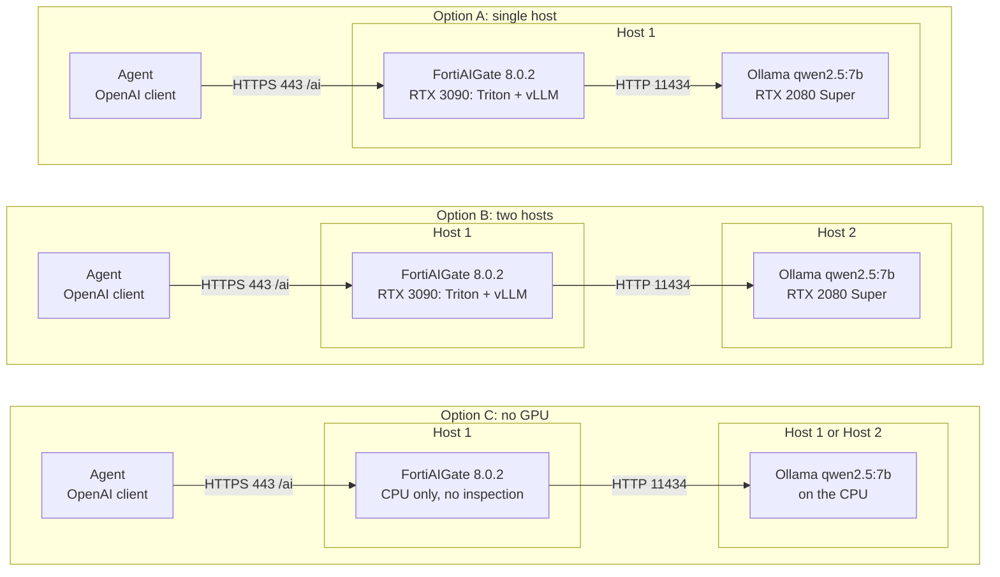

# FortiAIGate 8.0.2 + Ollama Lab Install Runbook

Oct 9, 2026 · @Ray

## Overview

This runbook builds a lab chain in which an agent reaches a local LLM only through FortiAIGate: agent, then FortiAIGate 8.0.2, then Ollama. FortiAIGate is deployed with the Docker Compose CLI (`deploy-docker-compose.sh` 0.6.2), and Ollama serves `qwen2.5:7b`.

Steps 1 to 9 run in order. Each step names the host it applies to, so the same runbook covers all three layouts below.

## Lab as built

The lab is Option C on two VMs with no GPU. A chat request works end to end and the gateway logs it, but nothing is inspected, because security scanning is paused without a GPU.

| Item | Value on 9 October 2026 |
| --- | --- |
| FortiAIGate host | 10.20.70.4, CLI installed in `/home/faig/FAIG` |
| Ollama host | 10.20.70.5 |
| Provider | `Ollama`, Custom (self-hosted), credential `ollama-remote` |
| Public model name | `ollama-qwen2.5` |
| Agent base URL | `https://10.20.70.4/ai/openai/v1` |
| Virtual key | `lab-agent`, global, service |
| Detector | `lab-secrets-regex`, action Block |
| Guardrail | `lab-baseline`, 3 detectors |
| Policy | `lab-default`, in use by all workspaces |
| Test agent | `faig_web.py` on 10.20.70.5, port 8080 |
| License | 1 GPU license, active until 2027-06-04 |
| GPUs in use | 0 |

| Test | Result |
| --- | --- |
| Chat request with `curl` through the gateway | HTTP 200, reply returned |
| Regex detector in the Playground | Reported successful |
| Canary string through the gateway with the policy in place | Not blocked; Traffic Log verdict was Log |
| Prompt from the web console | HTTP 200 after 41.4 s |

## Layout options

Pick one layout before you start. They differ in where Ollama runs, whether a GPU is used, and the firewall rule in Step 6.



In every layout the agent's only route to the model is FortiAIGate on Host 1. Option B moves Ollama and the 2080 Super to a second host, and Option C uses no GPU.

| Item | Option A: single host | Option B: two hosts | Option C: no GPU |
| --- | --- | --- | --- |
| FortiAIGate | Host 1 | Host 1 | Host 1, CPU-only |
| Ollama | Host 1 | Host 2 | Host 1 or Host 2, on the CPU |
| RTX 3090 (24 GB, compute capability 8.6) | Host 1, selected for FortiAIGate GPU inspection | Host 1, selected for FortiAIGate GPU inspection | Not used |
| RTX 2080 Super (8 GB, compute capability 7.5) | Host 1, pinned to Ollama | Host 2, used by Ollama | Not used |
| NVIDIA driver | Host 1 | Both hosts | Not needed |
| Docker and NVIDIA container toolkit | Host 1 | Host 1 only | Docker on Host 1, no toolkit |
| Who may reach Ollama on port 11434 | Docker networks on Host 1 | Host 1's IP address | As Option A on one host, as Option B on two |
| Guardrails available | Regular-expression, DLP and natural-language policy | Regular-expression, DLP and natural-language policy | None; scanning is paused without a GPU |

The 3090 goes to FortiAIGate because its policy model (vLLM) refuses a card below compute capability 8.0 and warns below about 22 GB. The 2080 Super goes to Ollama because `qwen2.5:7b` is a 4.7 GB model.

Choose Option B to make the gateway the only network path to the model, and to keep Ollama's GPU and memory use off the FortiAIGate host. If the two systems are VMs on one Proxmox host, pass each card through to its VM first; the driver steps inside the guest are the same.

Choose Option C when no NVIDIA card is available. FortiAIGate then runs CPU-only. The live 8.0.2 WebUI pauses security scanning in this mode and passes traffic uninspected, so the gateway routes, meters and logs requests but blocks nothing. Ollama also answers more slowly on the CPU.

Without GPU inspection, FortiAIGate runs CPU-only and the 3090 can go to Ollama instead. Security scanning is then paused, as in Option C.

## Before you start

The FortiAIGate CLI runs a preflight on every launch and exits on any FAIL, so check these on Host 1 first.

| Check on Host 1 | Requirement | If not met |
| --- | --- | --- |
| Operating system | Ubuntu 22.04 or later | Not supported |
| Operator account | Non-root user in an interactive terminal | CLI refuses to start |
| Docker Compose plugin | 2.23.1 or later | FAIL |
| Free space in Docker's data filesystem | 60 GB, 120 GB recommended | FAIL below 60 GB |
| Free space for CLI state | 5 GB, 10 GB recommended | FAIL below 5 GB |
| Outbound access to `fds1.fortinet.com:443` | Reachable | FAIL |
| NVIDIA container runtime | Registered with Docker whenever `nvidia-smi` works | FAIL, even for a CPU-only deployment |
| CPU cores | 8 or more | WARN |
| Memory | 32 GB CPU-only, 64 GB when a GPU is present | WARN |
| Docker Hub | Reachable, or the nginx, PostgreSQL and Redis images preloaded | WARN |

Have these files on Host 1 before Step 4:

- `deploy-docker-compose.sh` (CLI 0.6.2 or newer; older versions reject current 8.0.2 Triton images)
- The 8.0.2 release archives, named `FAIG_<component>-V8.0.2-build<N>-FORTINET.tar` or `.tar.gz`
- The FortiAIGate `.lic` license file

Host 2 in Option B needs only Ubuntu, the NVIDIA driver and about 5 GB of disk for the model.

## Step 1: Enable SSH (each host)

Run this at the console of each Ubuntu host. Every later step can then be done over SSH, which is how the FortiAIGate CLI expects to be run.

```bash
sudo apt update && sudo apt install -y openssh-server
sudo systemctl enable --now ssh
sudo ufw allow OpenSSH        # only needed if ufw is enabled
hostname -I                   # the address to connect to
```

From your own machine, `ssh-copy-id <user>@<host-ip>` sets up key login.

Give each host a fixed IP address or a DHCP reservation. Step 6 uses these addresses in firewall rules and in the FortiAIGate provider settings.

## Step 2: Install the NVIDIA driver (each host with a GPU)

Install the 580 driver branch on every host that holds a card; one driver covers both the RTX 3090 and the RTX 2080 Super. FortiAIGate's Triton image is tagged 25.11, and [Triton 25.11](https://docs.nvidia.com/deeplearning/triton-inference-server/archives/triton-inference-server-2670/release-notes/rel-25-11.html) requires driver release 575 or later on these cards.

Option C: skip this step, and leave the NVIDIA driver uninstalled on Host 1. The FortiAIGate preflight demands the container toolkit whenever `nvidia-smi` works.

1. Check Secure Boot. If it is enabled, the installer asks for a one-time MOK password, and you must enroll that key on the blue screen at the next reboot or the driver will not load.

   ```bash
   mokutil --sb-state
   ```
2. Apply pending system updates and reboot if the kernel changed. Then see which cards Ubuntu detects and which driver branches it offers.

   ```bash
   sudo apt update && sudo apt install -y ubuntu-drivers-common
   ubuntu-drivers devices
   sudo ubuntu-drivers list
   ```
3. Install the 580 branch and reboot. If `nvidia:580` is not offered, install the highest listed branch that is 575 or later.

   ```bash
   sudo ubuntu-drivers install nvidia:580
   sudo reboot
   ```

   On a host with no desktop, `sudo ubuntu-drivers install --gpgpu nvidia:580-server` installs the compute-only variant instead.
4. Confirm the driver sees each card, and record the UUIDs. FortiAIGate and Ollama are both pinned to cards by UUID.

   ```bash
   nvidia-smi --query-gpu=index,name,uuid,memory.total,compute_cap --format=csv
   ```

   On a host with both example cards the output looks like this (UUIDs shortened, index order may differ):

   ```text
   index, name, uuid, memory.total [MiB], compute_cap
   0, NVIDIA GeForce RTX 3090, GPU-aaaaaaaa-..., 24576 MiB, 8.6
   1, NVIDIA GeForce RTX 2080 SUPER, GPU-bbbbbbbb-..., 8192 MiB, 7.5
   ```

What each example card can run:

| Card | FortiAIGate policy model (vLLM) | FortiAIGate DLP model (Triton) | Ollama `qwen2.5:7b` |
| --- | --- | --- | --- |
| RTX 3090, 24 GB, capability 8.6 | Yes | Yes | Yes |
| RTX 2080 Super, 8 GB, capability 7.5 | No, the CLI requires 8.0 or later | Meets Triton 25.11's 7.5 minimum, untested at 8 GB | Yes |

In the FortiAIGate wizard, select only the 3090. Selecting both cards would give the 2080 Super to Triton and leave no card for Ollama.

## Step 3: Install Docker and the NVIDIA container toolkit (Host 1)

Host 1 needs Docker Engine, the Compose plugin and the NVIDIA container toolkit. The Ollama host in Option B needs none of them.

Option C: do items 1 and 2 only.

1. Install Docker Engine and the Compose plugin from Docker's repository.

   ```bash
   sudo apt-get update && sudo apt-get install -y ca-certificates curl
   sudo install -m 0755 -d /etc/apt/keyrings
   sudo curl -fsSL https://download.docker.com/linux/ubuntu/gpg -o /etc/apt/keyrings/docker.asc
   echo "deb [arch=$(dpkg --print-architecture) signed-by=/etc/apt/keyrings/docker.asc] https://download.docker.com/linux/ubuntu $(. /etc/os-release && echo $VERSION_CODENAME) stable" \
     | sudo tee /etc/apt/sources.list.d/docker.list
   sudo apt-get update
   sudo apt-get install -y docker-ce docker-ce-cli containerd.io docker-compose-plugin
   sudo usermod -aG docker $USER
   ```
2. Log out and back in so the group change applies, then confirm the Compose version is 2.23.1 or later.

   ```bash
   docker compose version
   ```
3. Install the NVIDIA container toolkit and register it with Docker. The preflight fails without this once `nvidia-smi` works, even for a CPU-only deployment.

   ```bash
   curl -fsSL https://nvidia.github.io/libnvidia-container/gpgkey \
     | sudo gpg --dearmor -o /usr/share/keyrings/nvidia-container-toolkit-keyring.gpg
   curl -s -L https://nvidia.github.io/libnvidia-container/stable/deb/nvidia-container-toolkit.list \
     | sed 's#deb https://#deb [signed-by=/usr/share/keyrings/nvidia-container-toolkit-keyring.gpg] https://#g' \
     | sudo tee /etc/apt/sources.list.d/nvidia-container-toolkit.list
   sudo apt-get update && sudo apt-get install -y nvidia-container-toolkit
   sudo nvidia-ctk runtime configure --runtime=docker
   sudo systemctl restart docker
   ```
4. Confirm a container can see the cards.

   ```bash
   docker run --rm --gpus all ubuntu nvidia-smi
   ```

## Step 4: Install FortiAIGate 8.0.2 (Host 1)

The CLI loads the release archives itself, generates the Compose project and starts the stack. Do not run `docker load` on the archives by hand.

1. Put the archives in one folder. Options A and B need all ten; Option C needs only the seven core images.

   | Set | Components in the archive names |
   | --- | --- |
   | Core | `api`, `webui`, `llm-gateway`, `logd`, `license_manager`, `guardrail`, `guardrail-scanner` |
   | GPU inspection | `custom-triton`, `faig-models`, `vllm-server` |
2. Install the CLI in its own directory and run the self-test. Always run it from this directory, because its state lives in `faig_deployment_assistant_data` beside the script.

   ```bash
   mkdir -p ~/faig && cp deploy-docker-compose.sh ~/faig/
   chmod 0755 ~/faig/deploy-docker-compose.sh
   cd ~/faig
   ./deploy-docker-compose.sh --self-test     # ends with "Self-test passed: ..."
   ./deploy-docker-compose.sh
   ```
3. Answer the setup wizard, which starts automatically after a clean preflight.

   | Prompt | Answer |
   | --- | --- |
   | Where are the FortiAIGate images? | `1`, then the absolute path of the archive folder, then the 8.0.2 release |
   | HTTPS port | `443` |
   | HTTP redirect port | `8081`, bound to 127.0.0.1 only |
   | Enable GPU content inspection | Yes in Options A and B, No in Option C |
   | GPU numbers | The number shown beside the RTX 3090's UUID, and only that one. Not asked in Option C |
   | LLM gateway memory in GB | `8` |
   | Log retention storage budget in GB | `16` |
   | Deployment namespace | `fortiaigate` |
   | Use a FortiCare proxy | No |

   In Options A and B the summary should then read "GPU placement: one GPU shared by Triton and vLLM". In Option C it reads "Policy model: unavailable (POLICY detectors fail closed)".
4. Deploy. Choose **3. Deploy or reapply Docker Compose**, answer Yes to creating the recovery archive, store the path it prints, then type `APPLY`.
5. Check the result with **4. Inspect or control the deployment**, then **1. Status and health**. In Options A and B the first start takes several minutes while the models load, and the health checks allow up to 30 minutes.

   | What you see | Meaning |
   | --- | --- |
   | `/ui` returns 502 shortly after apply | Still starting; wait and rerun the status check |
   | `/ai/` returns 403 | Expected until a license is imported |
   | Accelerator inventory with "scanning disabled by licence coverage" | Expected until a license is imported |
   | Triton and vLLM report healthy (Options A and B) | GPU inspection is up |
6. Open `https://<host1-ip>/ui`, accept the self-signed certificate warning, and create the administrator account.
7. Sign in, open the Licenses page and upload the `.lic` file.
8. Restart the API so the built-in detectors are created for the new organization, then run **Status and health** again.

   ```bash
   ~/faig/faig_deployment_assistant_data/deployment/compose.sh restart api
   ```

Store the recovery archive somewhere safe. It holds the deployment secrets and the stable deployment identity, which must never be regenerated.

## Step 5: Install Ollama and the model (Host 1 in Option A, Host 2 in Option B)

Ollama serves `qwen2.5:7b`, a 4.7 GB model with tool-calling support and a 32K context window ([Ollama library](https://ollama.com/library/qwen2.5)). It fits the 2080 Super's 8 GB.

1. Install Ollama.

   ```bash
   curl -fsSL https://ollama.com/install.sh | sh
   ```
2. Open a systemd override for the service.

   ```bash
   sudo systemctl edit ollama
   ```
3. Add these lines. The first makes Ollama listen on the network instead of only on localhost. The second raises the context window from the 4K default, which tool definitions fill quickly. Ollama's default is 4K on cards under 24 GiB.

   ```ini
   [Service]
   Environment="OLLAMA_HOST=0.0.0.0:11434"
   Environment="OLLAMA_CONTEXT_LENGTH=8192"
   ```
4. Option A only: add a third line that pins Ollama to the 2080 Super by its UUID from Step 2. Without it, Ollama can load the model onto the 3090 that FortiAIGate is using.

   ```ini
   Environment="CUDA_VISIBLE_DEVICES=GPU-<uuid-of-the-2080-super>"
   ```
5. Restart Ollama and pull the model.

   ```bash
   sudo systemctl restart ollama
   ollama pull qwen2.5:7b
   ```
6. Confirm the model answers on the OpenAI-compatible endpoint and runs on the intended card.

   ```bash
   curl http://localhost:11434/v1/chat/completions \
     -H "Content-Type: application/json" \
     -d '{"model":"qwen2.5:7b","messages":[{"role":"user","content":"ping"}]}'
   ollama ps        # PROCESSOR should read 100% GPU
   nvidia-smi       # the model's memory should appear on the 2080 Super
   ```

If Ollama has the 3090 to itself, `qwen2.5:14b` is the better choice.

Option C: skip item 4. Ollama runs the model on the CPU, so `ollama ps` reads 100% CPU and replies are much slower. If `qwen2.5:7b` is too slow, `qwen2.5:3b` is a 1.9 GB alternative, released under the Qwen license rather than Apache 2.0.

Ollama unloads an idle model after about five minutes, and the next request waits while it loads again. On a CPU that wait is long; one reply in this lab took 41 s. To keep the model loaded, add `Environment="OLLAMA_KEEP_ALIVE=24h"` to the override and restart Ollama.

## Step 6: Connect FortiAIGate to Ollama

Restrict port 11434 so that only FortiAIGate can reach Ollama, then register Ollama as the provider. Ollama has no authentication of its own, so the firewall rule is what stops clients bypassing the gateway.

| Setting | Option A: single host | Option B: two hosts |
| --- | --- | --- |
| Ollama address for FortiAIGate | `http://<host1-lan-ip>:11434/v1` | `http://<host2-ip>:11434/v1` |
| Firewall rule goes on | Host 1 | Host 2 |
| Source allowed to reach 11434 | Docker's networks, `172.16.0.0/12` | Host 1's IP address |

Option C uses the Option A column on one host and the Option B column on two.

Use the LAN address in Option A, never `localhost` or `127.0.0.1`. FortiAIGate runs in containers, and inside a container those names mean the container itself.

1. Option A: allow Docker's networks and block everyone else. Run on Host 1.

   ```bash
   sudo ufw allow OpenSSH
   sudo ufw allow from 172.16.0.0/12 to any port 11434 proto tcp
   sudo ufw deny 11434/tcp
   sudo ufw enable
   ```
2. Option B: allow Host 1 and block everyone else. Run on Host 2. Containers on Host 1 leave through Host 1's own address, so that is the address Host 2 sees.

   ```bash
   sudo ufw allow OpenSSH
   sudo ufw allow from <host1-ip> to any port 11434 proto tcp
   sudo ufw deny 11434/tcp
   sudo ufw enable
   ```
3. Test from a container on Host 1; it should list `qwen2.5:7b`. Then run the same `curl` from any other machine; it should fail.

   ```bash
   docker run --rm curlimages/curl -s http://<ollama-ip>:11434/v1/models
   ```

Then register Ollama and issue a key in the FortiAIGate WebUI. These pages were read on the live 8.0.2 system on 9 October 2026. 8.0.2 has no AI Guard or AI Flow pages; providers live under **Models** and client keys under **Virtual Keys**.

1. Open **Models**, click **Add Provider**, and choose **Custom (self-hosted)**. The OpenAI entry has a fixed catalog and no base URL field, so it cannot point at Ollama.
2. Fill in Integration Details.

   | Field | Value |
   | --- | --- |
   | Provider Name | `Ollama` |
   | Provider Slug | `ollama`. It prefixes every model's public name and cannot be changed later |
   | Base URL | The Ollama address from the table above, starting with `http://`. Ollama serves plain HTTP on 11434 |
   | API Format | OpenAI-compatible |
3. Click **Add Credential**. The form requires one even though Ollama does not check keys, so give it a name and a placeholder API key, and leave Weight at `1`.
4. Click **Add Model**. Set Model ID to the name exactly as `ollama list` shows it, such as `qwen2.5:7b`, and enter a price; the dialog requires at least one cost, and `0.01` is accepted. Click **Test Connectivity**, then **Save**, then **Add Integration**.
5. Open **Virtual Keys** and click **Create Virtual Key**.

   | Setting | Value |
   | --- | --- |
   | Scope | Global, unless you have created a workspace |
   | Key Type | Service |
   | Model Access | Add the Ollama provider and bind its credential. A global key inherits nothing |
   | Key Budget | Unlimited budget |
   | Policies, rate limits, expiry | Leave empty for the lab |

   Before saving, the Model Access summary should read 1 model, 1 provider, 1 credential.
6. Copy the secret key when it appears. It is shown only once.

Inspection rules live under **Detectors**, **Guardrails** and **Policy**. Step 8 sets them up.

## Step 7: Point the agent at FortiAIGate

The agent talks to FortiAIGate with the OpenAI chat-completions API and never contacts Ollama directly. Four things change in the agent: the base URL, the model name, the API key and certificate trust.

- **Base URL:** `https://<host1-ip>/ai/openai/v1`. The gateway serves three dialect namespaces, `/ai/openai`, `/ai/anthropic` and `/ai/gemini`, and rejects any other path under `/ai`.
- **Model name:** FortiAIGate's public model name, not Ollama's. In this lab it is `ollama-qwen2.5`. The `/models` call below lists the names a key may use.
- **API key:** the virtual key created in Step 6, not an Ollama value.
- **Certificate:** FortiAIGate serves a self-signed certificate. Copy `faig_deployment_assistant_data/deployment/web_certs/tls.crt` from the CLI's directory on Host 1 to the agent's machine and trust it. It is valid for Host 1's IP addresses, `localhost` and `127.0.0.1`.
- **API style:** if the agent uses Ollama's native `/api/chat` or the `ollama` Python library, switch it to an OpenAI client first.

Test from Host 1 before changing the agent. Set the key and certificate path first, each as its own command.

```bash
read -rsp "Key: " FAIG_KEY; echo
CERT=$(find ~ -path '*deployment/web_certs/tls.crt' 2>/dev/null | head -1); echo "$CERT"
```

```bash
curl -sS --cacert "$CERT" https://<host1-ip>/ai/openai/v1/models \
  -H "Authorization: Bearer $FAIG_KEY"

curl -sS --max-time 180 -w '\nHTTP %{http_code}\n' --cacert "$CERT" \
  https://<host1-ip>/ai/openai/v1/chat/completions \
  -H "Authorization: Bearer $FAIG_KEY" \
  -H "Content-Type: application/json" \
  -d '{"model":"ollama-qwen2.5","messages":[{"role":"user","content":"ping"}]}'
```

| Gateway error code | Meaning | Fix |
| --- | --- | --- |
| `no_such_namespace` | The path lacks a dialect prefix | Use `/ai/openai/v1/...` |
| `model_not_found` | The key cannot call that model name | Use a name from the `/models` list, or add the model to the key's Model Access |

Two ready-made clients use these settings. Keep both files in one directory on the machine that runs the agent, which is 10.20.70.5 in this lab.

| File | What it is |
| --- | --- |
| `faig_web.py` | Web console on port 8080. Shows each request's path, the gateway's decision, timing and tool calls |
| `faig_agent.py` | Command-line chat agent, and the core that the web console imports |

1. Copy both files to the agent machine and install the one dependency.

   ```bash
   sudo apt install -y python3-venv
   python3 -m venv ~/faig-agent
   ~/faig-agent/bin/pip install openai
   ```
2. Copy the gateway's certificate from Host 1.

   ```bash
   scp <user>@<host1-ip>:<cli-directory>/faig_deployment_assistant_data/deployment/web_certs/tls.crt ~/faig-tls.crt
   ```
3. Start the web console, paste the virtual key when asked, and open `http://<agent-host>:8080`.

   ```bash
   FAIG_CA_CERT=~/faig-tls.crt ~/faig-agent/bin/python faig_web.py --host 0.0.0.0
   ```
4. Or start the command-line agent instead.

   ```bash
   FAIG_CA_CERT=~/faig-tls.crt ~/faig-agent/bin/python faig_agent.py
   ```

Both clients default to this lab's gateway URL and model; set `FAIG_BASE_URL` and `FAIG_MODEL` to change them. The virtual key stays in the server process and is never sent to the browser.

The web console has no login, so anyone who can reach port 8080 can send prompts with the key. Without `--host 0.0.0.0` it listens only on 127.0.0.1. Limit the port to your workstation with `sudo ufw allow from <workstation-ip> to any port 8080 proto tcp`.

The console runs until Ctrl+C and stops when the SSH session closes; start it inside `tmux` to keep it running.

Its starter prompts cover a one-word reply, a tool call and the canary string. Streaming and tools each have a switch, which isolates a failure to one of them.

## Step 8: Add a detector, a guardrail and a policy (Host 1 WebUI)

Inspection is built from three objects: a detector holds the rules and the action, a guardrail bundles detectors, and a policy applies guardrails to models on the way in and on the way out. All three save without a GPU, but they enforce only when one is in use.

1. Open **Detectors**, click **Add Detector** and choose **Regex**. The other custom types are Data Leak Prevention and Natural Language.

   | Field | Value |
   | --- | --- |
   | Name | `lab-secrets-regex` |
   | Rule Name | `secrets-and-canary` |
   | Patterns | `FAIG-CANARY-7731` |
   |  | `-----BEGIN [A-Z ]*PRIVATE KEY-----` |
   |  | `AKIA[0-9A-Z]{16}` |
   | Action | Block |
2. Before saving, type `please repeat FAIG-CANARY-7731` into the **Playground** on that page and click **Run Test**. The Playground runs the deployment's own scanner and works without a GPU.
3. Open **Guardrails** and click **Create Guardrail**. Name it `lab-baseline`, add `lab-secrets-regex` from the Regex tab, add governance packs such as OWASP LLM Top 10 2025 Security Guard and General AI Safety Guard, and turn on **Deny Suspicious & invisible characters**.
4. Open **Policy** and click **Create Policy**.

   | Field | Value |
   | --- | --- |
   | Name | `lab-default` |
   | Models | Grant the Ollama provider |
   | Input guardrails | `lab-baseline` |
   | Output guardrails | `lab-baseline` |
   | Response scan mode | Post-stream, which scans the full response before delivery |
   | Apply to Organization | On |
5. Send the canary string through the gateway from the web console, then open **Logs** and read the Traffic Log. A verdict of Log means the request passed uninspected.

Fortinet ships 51 read-only governance packs, including OWASP LLM Top 10, OWASP Agentic Top 10, OWASP MCP Top 10, NIST AI RMF, MITRE ATLAS, IEC 62443 and NERC CIP.

In this lab the canary passed through with verdict Log, which confirms the WebUI banner: without a GPU, live traffic is not inspected, even by regex rules.

## Step 9: Set up the organization, workspaces, projects and users (Host 1 WebUI)

The hierarchy runs organization, workspace, project, virtual key. Budgets and model access narrow at each level.

| Page | What it is for | State in this lab |
| --- | --- | --- |
| Organization | Deployment-wide name, external URL and default budgets | Name `Example Org`, External URL `http://www.example.org`, budgets unlimited |
| Workspaces | A team's keys, models and guardrails, with traffic and spend kept apart from other teams | None |
| Projects | Groups keys inside a workspace under a shared budget and model access | None |
| Users | Accounts and invitations, with spend against budget | One Super Admin |

1. On **Organization**, set a real name and set External URL to `https://<host1-ip>`. Invitation links and single sign-on URLs are built from that field.
2. On **Workspaces**, create a workspace for the lab, then create a project inside it on **Projects**.
3. On **Virtual Keys**, create a workspace-scoped key for the agent, restart the agent with it, and delete the global `lab-agent` key.

## Verification and troubleshooting

The install is complete when every item below is ticked.

- [ ] `nvidia-smi` lists the expected card on each GPU host
- [ ] `./deploy-docker-compose.sh --self-test` ends with "Self-test passed"
- [ ] The preflight reports 0 failures
- [ ] Status and health shows every container up, `/ui` responding, and, in Options A and B, Triton and vLLM healthy
- [ ] The license is imported and the API has been restarted
- [ ] Ollama answers on `/v1/chat/completions` and the model sits on the intended card
- [ ] A container on Host 1 can reach port 11434; another machine cannot
- [ ] The agent gets a reply through FortiAIGate and the request appears in FortiAIGate's logs
- [ ] A prompt that a guard rule should block is blocked

| Symptom | Action |
| --- | --- |
| `nvidia-smi` cannot communicate with the driver after reboot | The Secure Boot key was not enrolled. Reinstall the driver and complete the MOK enrollment at boot, or disable Secure Boot |
| Preflight: "NVIDIA runtime is incomplete" | Run `sudo nvidia-ctk runtime configure --runtime=docker`, then `sudo systemctl restart docker` |
| Preflight: port 443 answers, or Kubernetes detected | Something else holds the port. Remove it, or rerun the wizard with HTTPS port `9443` |
| Apply stops: vLLM GPU has compute capability 7.5 | Only the 2080 Super was selected. Rerun the wizard and select only the 3090 |
| "Target images are incomplete" or "missing archive" | An archive is absent or misnamed. Check the file names against Step 4 |
| Triton or vLLM never becomes healthy on the shared 3090 | Check their logs with **5**, then **3. Show recent logs**. vLLM reserves 80% of the card. If Triton runs out of GPU memory, lower `VLLM_GPU_MEMORY_UTILIZATION` in `.env`, regenerate and reapply |
| FortiAIGate cannot reach Ollama | Check `OLLAMA_HOST`, the firewall rule, and that the provider address is a LAN IP rather than `localhost` |
| Ollama loads the model on the 3090 in Option A | Check the `CUDA_VISIBLE_DEVICES` UUID in the override, restart Ollama, and recheck with `ollama ps` |
| A service is unhealthy | Main menu **5**, then **3. Show recent logs**, and enter the service name |

## Open items

Routing, logging and the test agent work. Enforcement does not, and it cannot in this lab as built. Six points remain open.

- [ ] Get a GPU under FortiAIGate. Neither VM has one, so the policy cannot enforce. The options are a host with a supported NVIDIA card, a cloud instance with an A10 or L4, or asking the FortiAIGate product team whether an evaluation switch exists for CPU-only scanning.
- [ ] Do not try to emulate a GPU. The DLP and natural-language detectors need real CUDA hardware, and the GPU count comes from the license reporters in the engine containers.
- [ ] Replace the `lab-agent` test key with a fresh one; its value was shared during setup.
- [ ] Fix the Organization name and External URL, and create the workspace and project in Step 9.
- [ ] Confirm tool calls through the gateway with the web console's subnet prompt. A streamed reply has worked; tool calls are untested.
- [ ] If a single 24 GB card is used later, confirm that Triton and vLLM both load on it and that the host has the 64 GB the CLI recommends.

## Sources

- FortiAIGate Docker Compose CLI user guide and `deploy-docker-compose.sh` 0.6.2, supplied with the 8.0.2 release
- [FortiAIGate 8.0.1 Administration Guide, Appendix B](https://docs.fortinet.com/document/fortiaigate/8.0.1/fortiaigate-administration-guide/92184/appendix-b-sample-configuration-for-ai-agents)
- [Triton Inference Server 25.11 release notes](https://docs.nvidia.com/deeplearning/triton-inference-server/archives/triton-inference-server-2670/release-notes/rel-25-11.html)
- [UbuntuHandbook: NVIDIA 580 driver in the official Ubuntu repositories](https://ubuntuhandbook.org/index.php/2025/09/ubuntu-added-nvidia-580-driver/)
- [Ollama library: qwen2.5](https://ollama.com/library/qwen2.5)
- [Ollama documentation: context length](https://docs.ollama.com/context-length)
